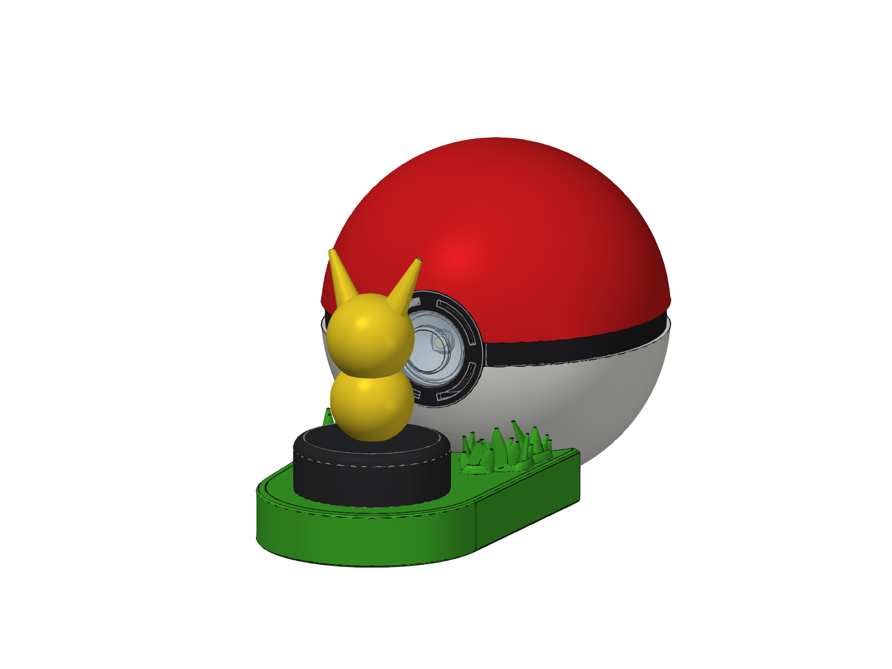

# Poké Ball in the tall grass, for the Tonie hunt

A 100 mm Poké Ball with a tongue of tall grass in front of it. It speaks, reads a Tonie figure that is stood on the grass in front of it, signals closeness with its glowing button and, on a command from the phone, jumps open to present an engagement ring.



This repository holds the hardware design: research, a parametric CAD model, a geometry verification suite and the building manual. Firmware and phone app are not written yet; `docs/electronics.md` shows that the hardware can carry them.

## Where things are

| Path | Content |
| --- | --- |
| `docs/building_manual.md` | bill of materials, print settings, twelve assembly steps with renderings, exploded view, commissioning, emergency opening |
| `docs/electronics.md` | block diagram, power rails, net list, pin map, harness to the grass tongue, behaviour the firmware must respect |
| `docs/verification.md` | result of every geometry check (watertightness, fit, clearances, motion, grass tongue, physics) |
| `research/` | ten research notes with sources, including the candidates that were rejected; start with `research/README.md` |
| `export/stl/` | the 15 printed parts, already in print orientation |
| `export/step/` | the same parts, the dummy models of all purchased components and the full coloured assembly |
| `src/poketonieengagementhunt/` | the CAD model as Python (CadQuery); `params.py` holds every dimension |
| `.specspec/` | the specification graph: owner intentions, design conclusions and the artifacts that realise them |

## Regenerating everything

```sh
uv run poketonieengagementhunt check     # verification -> docs/verification.md
uv run poketonieengagementhunt export    # STL and STEP  -> export/
uv run poketonieengagementhunt manual    # renderings and manual -> docs/
uv run poketonieengagementhunt all
```

Change a value in `src/poketonieengagementhunt/params.py` (for example the ring dimensions, or the values marked `MEASURE` once the parts have arrived) and run `all`. The checks fail loudly if the change makes parts collide.

## Revisions

**Revision 2.** Revision 1 read a Tonie at the flat underside of the ball, which invited turning the ball over. Revision 2 keeps the ball upright:

- A Tonie stands on a plain, level spot of green "tall grass" in front of the ball; nothing holds it.
- The reader, now the common blue PN5180 board, lies directly under that spot, with the hall switch that wakes the ball.
- The ball itself is unchanged except for its bowl, which lost the dock and gained screw bosses and a hidden cable window, and its chassis, which no longer carries a reader.

**Revision 3.** The grass of revision 2 was a ring round the ball's foot plus a tongue. Revision 3 keeps the tongue alone:

- No grass round the ball. The rear end of the tongue lies under the belly of the ball and is held by four screws from below.
- The tongue is 15 mm high instead of 6.5 mm, and its underside lies in the plane of the ball's flat foot: both stand on the table together.
- The grass is drawn by a random generator. Place, size, direction and leaf shape differ from tuft to tuft, and no tuft has a twin on the other side. `LAWN_SEED` in `params.py` gives another lawn.
- The hall switch is laid out for the magnets of the classic Tonies and lies deeper, so that it also catches magnets beside the axis. The bare ground round the spot is 2 mm wider.
- The antenna lies 11.7 mm above the table instead of 3.2 mm, which eases the risk of a metal table.

**Revision 4.** One colour, and a smaller tongue:

- Tongue and grass are one light green. The grass top, turf plate and tufts together, is one printed part. The bright disc that marked the place of the figure is gone, and nothing marks that place now: the owner's decision, with the risk accepted.
- The tongue is 72 mm wide at the ball and 66 mm at its round tip instead of 76 mm, and reaches 70 mm beyond the ball instead of 76 mm. Its height is unchanged. The tip is a circle round the place of the figure, so a centred figure shows the same 10.5 mm of ground at the front and at both sides.
- The grass is thinner and stands in the two corners beside the ball. None stands beside or in front of the figure.
- The grass top lies in a frame: a rim of the tray holds its tip, and four hidden screws hold its rear half.

## State of the design

- 88 of 88 geometry checks pass. All 15 printed parts are valid and watertight; the closed assembly of 40 items has no collisions; the lid has been swept through its 95° travel in 39 positions without contact; latch, ring lock, emergency opening and the assembly sequence are checked the same way.
- For the grass tongue the checks cover the seat of the ball on four pads, the flush underside, the reader pocket, the frame that holds the grass top, the hidden cable path, the clearance between a figure and the ball, the plain standing surface, where the grass stands and that it is not mirrored, the hidden ends of the turf screws, and the stance: the centre of gravity stays at least 24 mm inside the edge of the area on which ball and tongue stand.
- Not provable in CAD, and therefore the first thing to do (building manual, section 2): read all four Pokémon Tonies with the blue PN5180 board under a 1.6 mm sheet, on wood and on metal, find the magnets in their feet, and see how far off the middle a figure may stand. The tag is a small rod somewhere above the foot. The magnets are assumed to be those of the classic Tonies; `docs/electronics.md` says what to do if they are not.
- Dimensions of some delivered parts, of the figures and of the ring are still assumptions. They are marked `MEASURE` in `params.py`. The foot of a figure (45 mm, measured on pictures) sets the round tip of the tongue and the ground that is kept free of grass.
