# Building manual: Poké Ball in the tall grass, for the Tonie hunt

This manual is generated by `uv run poketonieengagementhunt manual` from the CAD model in `src/poketonieengagementhunt/`. Pictures, part numbers and dimensions therefore always match the model. The balloons in every picture carry the position numbers of the bill of materials in section 1.

| Closed | With a Tonie | Open |
| --- | --- | --- |
| 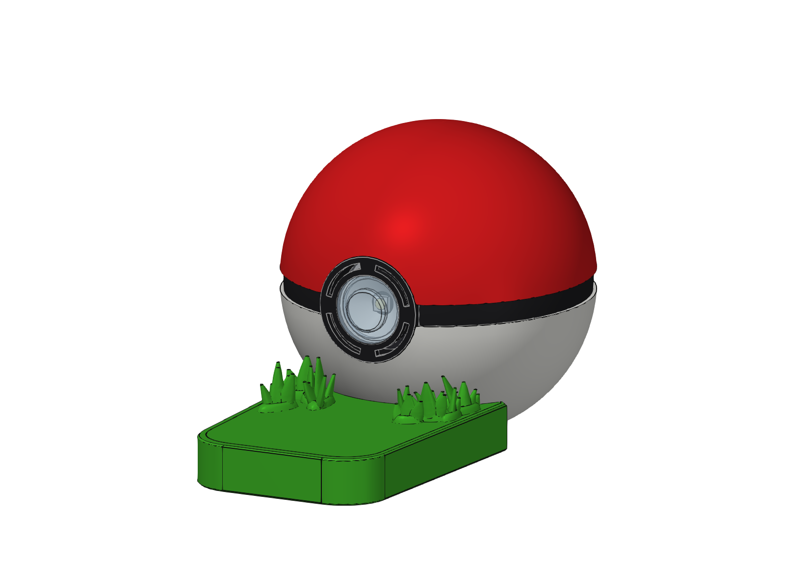 |  |  |

## What you are building

A 100 mm Poké Ball with a tongue of tall grass in front of it. The tongue is a block screwed under the lower front of the ball: 72 mm wide at the ball, 66 mm beside a figure, 15 mm high without the blades, and it reaches 61.5 mm beyond the ball, just past the reader board inside it. Tongue and grass are one light green. Nothing of the tongue lies beside or behind the ball, and its underside lies in the plane of the ball's flat foot, so ball and tongue stand on the table together. A Tonie is stood at the front end of the tongue, in front of the ball. That wakes the ball, which reads the figure's RFID tag and plays that figure's recorded message from its own flash memory. Because the figure stands on the grass, the ball always stays upright.

The ball's black front ring carries the sound slits and its button is a lens lit by an RGB LED. The red half is a spring-loaded lid on a concealed hinge. A servo releases its latch on command from the phone, and the lid jumps open to present the ring, which stands in a slot of the deck and is locked there by a pawl that passes through it.

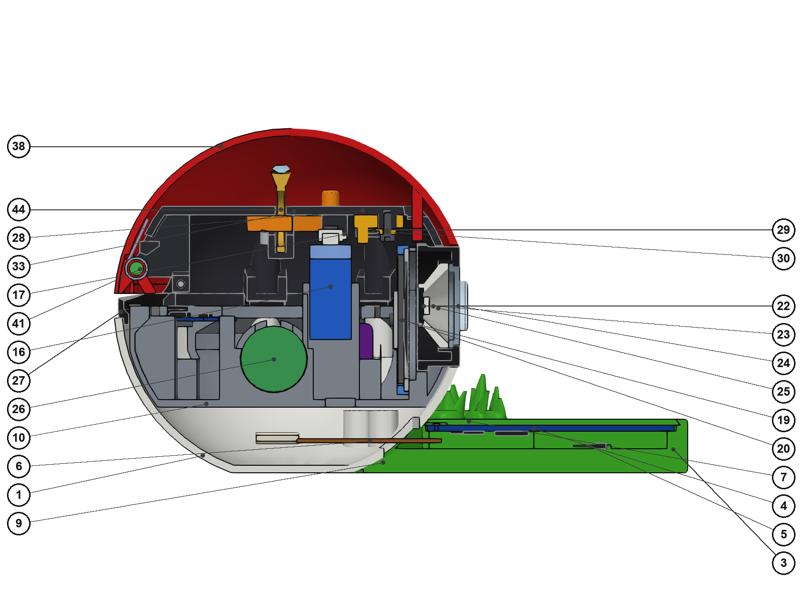

*Section through the centre plane, seen from the right-hand side. Front (button and tongue) is on the right.*

Before you start: read `research/README.md` for why each part was chosen, `docs/electronics.md` for the wiring, and `docs/verification.md` for what has and has not been verified. The firmware and the phone app are not part of this manual.

**Safety.** A bare 18650 cell can deliver dangerous currents: never short it, never solder on it, and do not leave the ball in a hot car (PETG softens near 70 °C). The heat-set inserts are pressed in at about 230 °C. No magnets are used in the device. The only magnets involved are those inside the Tonies.

## 1. Bill of materials

### Purchased components

| Pos. | Qty | Part | What to buy | Research |
| --- | --- | --- | --- | --- |
| 4 | 1 | PN5180 NFC reader (blue board, 70 x 39 mm) | The common blue PN5180 module, about 70 x 39 mm, silkscreen "PN5180-NFC" (AliExpress, Amazon, eBay, AZ-Delivery). Prefer a listing whose pin header is supplied loose. The bag usually holds two test tags as well. | research/02 §1A, 08 |
| 5 | 1 | Hall switch, TO-92 (DRV5032FB or AH3661UA) | TI DRV5032FB hall switch in TO-92 (4.0 x 3.15 x 1.52 mm). If it cannot be had: AH3661UA in the same package (Conrad order number 1569221, TRU COMPONENTS), which needs a 1 MOhm pull-up resistor; see `docs/electronics.md`. Buy three or four: fit the one that answers to a magnet from furthest away, and keep one for the spare wire in case one switch does not catch the magnets. | research/04 §5, 09 §7, 10 C5 |
| 6 | 2 | Reader harness: 6-pin plug-and-socket pair with wires | Two pre-wired 6-pin wire-to-wire pairs with 1.25 mm pitch and at least 15 cm of 28 AWG wire on each half. Sold as "Micro JST 1.25 mm 6-pin male and female with wire"; the original parts are Molex PicoBlade 51021-0600 and 51047-0600. One half goes to reader and hall switch, the other to the core. | research/10 C1 |
| 11 | 2 | 18650 contact plates (+ dimple, - spring) | One spring and one button contact plate for AA/18650 holders, about 10 x 10 mm. | research/05 §3.2 |
| 12 | 1 | Seeed XIAO ESP32-S3 Plus | Seeed XIAO ESP32-S3 Plus (16 MB flash, 8 MB PSRAM) with its U.FL antenna. Fallback: Unexpected Maker TinyS3 (needs a longer pocket). | research/04 §1, 07 §11 |
| 13 | 1 | MAX98357A I2S amplifier | MAX98357A I2S class-D amplifier breakout (Adafruit #3006 or clone), terminal block not fitted. | research/04 §2 |
| 14 | 1 | TP4056 USB-C charger with protection | TP4056 USB-C charger module with DW01A protection, 28 x 17 mm. Change R_PROG to 2.0-2.4 kOhm for about 0.5 A. | research/05 §4.1 |
| 15 | 1 | 5 V boost converter (Adafruit MiniBoost TPS61023) | Adafruit MiniBoost 5V @ 1A (TPS61023), #4654, with enable pin. | research/05 §4.3 |
| 16 | 1 | 9 g micro servo (SG90 class) | Any SG90-class 9 g micro servo with its horns and screws. | research/05 §1 |
| 17 | 1 | Servo horn (stock single arm) + screw | The single-arm horn from the servo bag, trimmed to 13 mm. | research/05 §1.3 |
| 19 | 1 | Speaker Visaton K 40 (8 ohm) | Visaton K 40, 8 ohm, art. no. 2840 (Ø40 x 4.3 mm, 83 dB). | research/04 §3 |
| 22 | 1 | RGB LED WS2812B on 10 mm PCB | One WS2812B or SK6812 on a round Ø10 mm mini PCB. | research/04 §4 |
| 26 | 1 | 18650 Li-ion cell (unprotected flat top) | Unprotected flat-top 18650, e.g. Samsung INR18650-35E or Molicel M35A. | research/05 §2 |
| 40 | 1 | Torsion spring T028-180-140 (0.71 x 6.32 mm, 6 turns, 180°) | Stainless torsion spring T028-180-140, L or R: 0.71 mm wire, 6.32 mm outside, 6 turns, legs in one line (180°) and 25.4 mm long. Sodemann sells it to private customers as T028-180-140L / T028-180-140R, Febrotec lists the same spring as 0T028-180-140L / 0T028-180-140. Either winding direction fits; order a few. Its legs are cut to 14 mm (step 10). The sleeves of 4.0 mm outside are printed for this spring; a sleeve's file name begins with its outside diameter (section 3). Two springs of the same family as second guesses, both on the thicker sleeve of 4.5 mm: 0T023-180-156 (0.58 mm wire, 6.58 mm outside, 4 turns) if the lid opens too hard, about 26 N mm instead of about 40, and 0T030-180-172 (0.76 mm wire, 6.91 mm outside, 6 turns) if it opens too weakly, about 50 N mm. Any other spring of 0.7 mm wire with 6 or 7 turns and 6.3 to 7.0 mm outside fits the lid and the stage as well, but wants a sleeve about 0.6 mm thinner than its inner diameter with the lid closed (`SLEEVE_OD` in `params.py`). | research/06 §2.1 |
| 43 | 1 | Engagement ring (EU 49) | The engagement ring. Its slot in the stage is 3.1 mm wide, 25 mm across and 13 mm deep (`RING_SLOT_W`, `RING_SLOT_D`, `RING_SLOT_DEPTH` in `params.py`); what the ring leaves free is filled with paper or cloth. | research/06 §1, §1.6 |

### Hardware

| Pos. | Qty | Part | Note | Research |
| --- | --- | --- | --- | --- |
| 2 | 8 | Heat-set insert M3, Ø5 (four x 6 mm, four x 5 mm) | M3 heat-set inserts that measure 5.0 mm over the knurl: four of 6 mm for the rim, four of 5 mm for the lower bosses. The holes are 4.4 mm. Inserts of 4.6 mm (ruthex / CNC Kitchen M3 x 5.7) need 4.0 mm holes: set `M3_INSERT_HOLE` in `params.py` and export the bowl again. | research/06 §4.1 |
| 8 | 4 | Screw M2 x 6 (grass top to tray) | M2 x 6 machine screws with a cylindrical head and hex socket, ISO 4762 / DIN 912. Any head up to Ø4.0 x 2.0 mm fits; a countersunk head does not. They form their own thread in the printed pilot holes. | research/06 §4.2, §4.3 |
| 9 | 4 | Screw M3 x 16 countersunk ISO 10642 (tongue to bowl) | M3 x 16 countersunk screws with hexagon socket, ISO 10642 or DIN 7991. Cross-head countersunk screws M3 x 16 (DIN 965, head 5.5 to 6 mm) fit as well. | research/10 C2 |
| 18 | 2 | Servo mounting screw 2 x 8 (supplied with servo) | Supplied with the servo. | research/05 §8.1 |
| 21 | 2 | Screw M2 x 8 (speaker clamp) | M2 x 8 machine screws with a cylindrical head and hex socket, ISO 4762 / DIN 912. It has to be a hex socket here: the two screws lie deep in the core, where only a hex key reaches them. | research/06 §4.2, §4.3 |
| 31 | 1 | Screw M2 x 6 (pawl pivot) | M2 x 6 machine screw, the same as for the grass top. The washer under it is printed. | research/06 §4.2, §4.3 |
| 32 | 1 | Compression spring about 4 x 12 (pawl return) | Soft compression spring of 3.5 to 4.5 mm outside diameter, 12 mm long: 12 mm cut off the spring of a ball-pen. | research/06 §2.2 |
| 34 | 2 | Washer M3 and washer M2 (ring pawl pivot) | One standard M2 washer (Ø5 x 0.3 mm) under the head of the screw and one standard M3 washer (Ø7 x 0.5 mm) between it and the pawl. The M3 washer keeps the pawl on its boss; the M2 washer alone is narrower than the pawl's bore. | research/06 §3 |
| 35 | 1 | Screw M2 x 6 (ring pawl pivot) | M2 x 6 machine screw, the same as for the latch pawl. | research/06 §4.2, §3 |
| 36 | 1 | Compression spring 4 x 15 (ring pawl return) | Compression spring of 4 mm outside diameter and 15 mm length, not cut: of the same kind as the one that is cut to 12 mm for the latch pawl. | research/06 §3 |
| 38 | 2 | Dowel pin 2 x 8 (hinge) | Two steel dowel pins (parallel pins) Ø2 x 8 mm, ISO 2338 / DIN 7 or hardened ISO 8734 / DIN 6325. Two pieces of a 2 mm bicycle spoke, 8 mm long with rounded ends, do as well. They slide in the towers of the stage and are pressed into the spring sleeve. Which of the printed sleeves holds them has to be found by trying, before the hinge is put together (section 3). | research/06 §3 |
| 41 | 1 | Dowel pin 2 x 18 (seat of the spring leg) | Steel dowel pin (parallel pin) Ø2 x 18 mm, of the same kind as the hinge pins. The forward leg of the lid spring rests on it; it goes in last (step 10). | research/06 §3 |
| 42 | 4 | Screw M3 x 16 ISO 4762 (stack) | M3 x 16 socket head cap screws, ISO 4762. | research/06 §4.3 |

### Small parts without a position number

| Part | Qty | Used for |
| --- | --- | --- |
| Electrolytic capacitor 470-1000 µF / 10 V | 1 | C3: across the 5 V output of the boost converter, close to the servo |
| Electrolytic capacitor 220-470 µF / 10 V | 1 | C2: across the battery input of the boost converter |
| Resistors 2 MOhm and 1 MOhm, capacitor 100 nF | 1 each | R1, R2, C1: battery voltage divider at the ADC pin |
| Resistors 4.7 kOhm | 2 | R4, R5: pull-downs on boost enable and amplifier SD; this small because both boards carry a pull-up (`docs/electronics.md`) |
| Resistor 100 kOhm | 1 | R3: pull-down on reader RST |
| Resistor 1 MOhm, capacitor 100 nF | 1 each, only with the AH3661UA hall switch | R6, C4: pull-up from the wake pad to 3.3 V at the controller; capacitor across the supply legs of the switch |
| Diode 1N4148 | 1 | D1: in series with the LED's 5 V supply, so that 3.3 V data is in spec |
| Silicone wire 26-28 AWG, heat-shrink tube |  | all point-to-point wiring |
| Soft cloth or paper |  | wrapped round the ring and stuffed into its slot |
| Self-adhesive felt or velour, 0.5-1 mm |  | optional curtain behind the band pocket; optional dots under the ball's flat and the tongue |
| Hot glue or epoxy; cyanoacrylate |  | boards, bezel, hall switch, reader |
| Flexible ferrite sheet 0.1-0.2 mm, about 45 x 42 mm (Würth WE-FSFS 364004 or 364005) | 1, only if needed | on the floor of the pocket under the antenna, if the bench test fails on a metal surface |
| Schottky diodes BAT43 or 1N5817 | 2, only if needed | D2, D3: supply of the reader in sleep, if the ball is woken by card detection instead of the hall switch |

### Printed parts

| Pos. | Part | File | Filament | Mass | Print orientation |
| --- | --- | --- | --- | --- | --- |
| 1 | Bowl (white lower half) | `export/stl/bowl.stl` | PETG white | 41 g | rim on the bed (dome up), tree supports inside only |
| 3 | Grass tongue (tray) | `export/stl/grass_base.stl` | PETG light green | 78 g | sole on the bed, no supports |
| 7 | Grass top (turf plate with its tufts) | `export/stl/grass_top.stl` | PETG light green | 13 g | underside on the bed, tufts up, no supports |
| 10 | Chassis | `export/stl/chassis.stl` | PETG any colour | 52 g | plate on the bed, supports under the baffle disc and shelf |
| 20 | Speaker clamp ring | `export/stl/spk_clamp.stl` | PETG any colour | 1.1 g | flat on the bed |
| 23 | Light cone | `export/stl/cone.stl` | PETG white | 1.4 g | large end on the bed |
| 24 | Button lens | `export/stl/lens.stl` | PETG natural / clear | 1.5 g | flange on the bed, button up, 100 % infill |
| 25 | Button bezel (black ring with sound slits) | `export/stl/bezel.stl` | PETG black | 3.1 g | face down on the bed, no supports |
| 27 | Band (black equator ring) | `export/stl/band.stl` | PETG black | 5.9 g | upside down: lid seat on the bed, no supports |
| 28 | Stage (inner dome with ring deck) | `export/stl/stage.stl` | PETG black | 32 g | upside down: deck on the bed, supports under the stop beam of the hinge and the screw pads only |
| 29 | Latch pawl | `export/stl/pawl.stl` | PETG any colour | 0.5 g | upside down: top face on the bed |
| 30 | Pivot washer for the pawl | `export/stl/pawl_cap.stl` | PETG any colour | 0.0 g | flange on the bed, hub up; 100 % infill |
| 33 | Ring pawl (lock of the ring) | `export/stl/ring_pawl.stl` | PETG any colour | 1.7 g | as it lies, knob up, no supports; 100 % infill |
| 37 | Lid (red upper half) | `export/stl/lid.stl` | PETG red | 35 g | rim on the bed (dome up), supports inside only (hook, pole) |
| 39 | Spring sleeve | `export/stl/sleeve_4_0_hole_1_85.stl` to `sleeve_4_0_hole_2_05.stl`: 5 sleeves that differ in their holes; which one is used has to be found by trying (section 3) | PETG any colour | 0.1 g | standing on one end; 100 % infill |

### Tools

- FDM printer with a 0.4 mm nozzle; PETG in red, white, black, natural (clear) and a light green, and any colour for the inner parts
- Soldering iron with a fine tip (also used to set the heat-set inserts)
- Hex keys 1.5, 2 and 2.5 mm, long-nose pliers, small cross-head screwdriver, small flat screwdriver (blade 2 to 2.5 mm wide), side cutters, tweezers, a toothpick
- Drill bits of 1.7 or 1.8 mm and of 2.0 mm, only if a pilot hole for an M2 screw or a bore for one of the pins prints too tight
- Multimeter; a USB-C cable and charger
- Calipers, to measure the ring, the reader board and the other delivered boards

## 2. Test on the bench before you print

Five things decide whether the design works, and none of them can be proven by CAD. Test them with loose parts and the real figures first:

1. **Tonie reading.** Wire the PN5180 board to the XIAO and flash any firmware that performs the SLIX-L privacy unlock (see `research/01` and `research/07`). Lay the board on a wooden table with the components down, on two strips of cardboard about 2 mm thick, as it will lie in the tray. Cover it with a sheet of plastic 1.6 mm thick and stand each of the four figures on the middle of the antenna. All four must read. The tag is a small upright rod somewhere inside the figure, perhaps several centimetres up, so find the reserve: raise each figure on books or coasters until it stops reading, and slide it sideways until it stops reading. Note both distances and which privacy password each figure needs.
2. **Metal under the tongue.** Repeat test 1 with a baking tray 12 mm under the board: that is a metal table under the tongue. The distance is a little more than the 10 mm that the antenna guides ask for [research/08 §8], so the figures should still read. If they do not, lay the ferrite sheet from the list of small parts 5 mm under the board, where the floor of the pocket will be, and repeat on both surfaces.
3. **The magnets.** The pocket is laid out for the magnets of the classic Tonies, which the Pokémon figures should share because they work on the first Toniebox: cylinders of 6 x 6 mm, one in the middle of the foot or one in each of two feet [research/09 §7]. Find them with a steel pin or a compass needle. Then fix the hall switch under the middle of the antenna with its printed face 5 mm below the plastic sheet (a stack of cardboard does it): that is where it lies in the tongue. It must switch when a figure stands on the sheet, in every rotation of the figure, and release when the figure is lifted away. Then slide the figure off the middle and note how far it can stand off before the switch lets go and before the read fails. Nothing marks the place on the tongue, so this distance is the reserve for a figure that is put down by eye; about 8 mm is what the layout counts on. If the switch does not answer at all, read "Wake, if the magnet is not where the switch is" in `docs/electronics.md` before you go on.
4. **Servo and supply.** Run the servo from the boost converter on the real cell while the amplifier plays. The board must not reset. Measure the stall current.
5. **Lid spring and hinge pins.** Print the sleeves and the test piece for the hinge pins, and find the sleeve that holds the pins and the bore in which they slide (section 3). Then print the lid, the stage and the band, hinge the lid (step 10) and check that the spring throws it open and that it rests on the end stop.

Also measure the delivered parts against the values marked `MEASURE` in `params.py`: outline of the reader board (69.6 x 38.6 mm assumed; it sets the length of the tongue) and position of its antenna, the foot of a figure (45 mm assumed; the width of the tongue follows it), height of the XIAO, length of the charger and position of its USB-C socket, and the ring itself.

## 3. Print the parts

*All printed parts in their print orientation. The STL files in `export/stl/` are already turned this way.*

- Material: PETG for every part. The hinge, the latch and the spring seats stay under load for weeks, and PLA creeps and softens at 55-60 °C.
- 0.2 mm layers, 5 perimeters for the shells (they print solid), 4 perimeters and 30 % infill for the inner parts, 100 % for the two pawls, sleeve and lens.
- Bowl, lid: rim on the bed, tree supports inside only. Put the layer seam at the back. A variable layer height (0.1 mm near the pole) hides the stair-stepping on the cap.
- Band, stage: upside down. Their 45° surfaces are designed to print without support in this orientation.
- Lens: natural (uncoloured) PETG. Print one first and check the glow with the LED; 1.6 mm front thickness is `LENS_T` in `params.py`.
- Bowl: the four bosses low on its front wall hang from the dome in print orientation. The tree supports that the floor needs anyway carry them.
- Grass tongue (tray): light green, sole on the bed, no supports, 4 perimeters, 40 % infill. The rim round its top overhangs inwards at the tip by less than 40°; it prints without support.
- Grass top: the same light green, one file (`grass_top.stl`): underside on the bed, tufts up, no supports, 5 perimeters so that the blades print solid. Slow down above the turf surface and keep a minimum layer time of about 8 s, so that the blunt tips do not melt. Its edge leans like the walls of its frame, and its lowest 0.3 mm stand back a little for a first layer that is squeezed wide. If it still does not drop into the frame, scrape its bottom edge with a knife.
- A green that comes close to the grass of the games: Bambu PETG HF Green [research/10 A.4]. Tray and grass top should come from the same spool.

**Supports.** The slicer makes them; nothing about them is built into the files. In Bambu Studio (or any other slicer) choose tree supports with a threshold angle of 30° and, with PETG on PETG, a top Z distance of one layer (0.2 mm), so that they break off. Look at the sliced preview before printing. Where they are needed, measured on the exported files with `research/scripts/print_supports/overhang.py`:

| Part | Supports | Setting |
| --- | --- | --- |
| Bowl | inside: under the floor (about 50 x 50 mm, 37 to 42 mm above the bed) and under the four bosses low on the front wall | on build plate only |
| Lid | inside: under the top of the dome (about 50 x 50 mm, 37 to 45 mm above the bed) | on build plate only |
| Stage | under the stop beam between the hinge towers (about 7 x 14 mm) and under the four screw pads; none in the bores and none under the knuckles of the hinge, which slope at 45° | on build plate only |
| Chassis | under the two shelves at the back, where they stand on the part itself, and under the lugs of the flange | everywhere, not only from the build plate |
| Lens | optional, under its front (19 mm across, 1.5 mm above the bed); without them it is bridged | - |
| Band | optional, under the shallow pocket at the back (2 mm high) | - |
| All other parts | none | supports off |

- Print the two pawls, the pivot washer and the sleeves first. They are small and show whether your printer's clearances suit: each pawl must turn freely on its boss of the stage.
- Play and tolerances. A printed surface may lie a few tenths of a millimetre beside where the model has it, and a printed hinge has play. The parts are laid out for both: every gap between the lid and what it passes is 0.5 mm or more (collar of the stage 0.6, ring of the button 0.6, ribs beside the hinge towers 0.5, hook in its slot 0.5 mm), so that two surfaces which both come out 0.2 mm fat still do not touch, and the lid may stand 1.7° askew in its hinge without meeting anything but its guides [`docs/verification.md`, section Play and tolerances]. What the model cannot know is your first layer. The lid stands on its rim while it is printed: if that rim comes out with a bulge (an elephant foot), scrape the inside of the rim clean with a knife, because the collar of the stage sits just inside it.
- M2 pilot holes. The seven M2 screws form their own thread in printed holes: 1.95 mm where the mouth of the hole lies parallel to the print bed (grass top, stage) and 1.7 mm where it lies in an upright wall (chassis) [research/06 §4.2]. How such small holes come out depends on printer and filament, so print `export/stl/m2_test_coupon.stl` first, flat as it comes, in the PETG you will use. It has three holes from the top (1.85, 1.95, 2.05 mm) and three through its side (1.60, 1.70, 1.80 mm), the smallest of each three next to the cut-off corner. An M2 screw should turn into the middle one with light, even resistance and then hold firmly. If a neighbour fits better, change `M2_PILOT_FLAT` or `M2_PILOT_SIDE` in `params.py` and export again. A hole that is only a little tight can be opened with a 1.7 or 1.8 mm drill.
- Hinge pins and their sleeve. The two Ø2 pins slide in the towers of the stage and are pressed into the two ends of the spring sleeve; that press fit is all that keeps them in the hinge. Which hole gives that fit cannot be read from the drawing: it depends on printer and filament and **has to be found by trying**. The sleeve is therefore exported five times in `export/stl/`, alike but for its two blind holes: `sleeve_4_0_hole_1_85.stl`, `sleeve_4_0_hole_1_90.stl`, `sleeve_4_0_hole_1_95.stl`, `sleeve_4_0_hole_2_00.stl` and `sleeve_4_0_hole_2_05.stl`. The name of a sleeve file says its sizes in millimetres, first the outside diameter and then the hole: `sleeve_4_0_hole_1_95` is 4.0 mm outside with holes of 1.95 mm.
  - Print all five sizes in one job, two of each, standing on one end and set a little apart, in the PETG of the stage. A sleeve that is printed alone gets a new layer every second or two, stays soft and comes out thinner than drawn, with its holes closed.
  - Off the bed the sizes cannot be told apart by eye. Take the sleeves off in the order of the job and lay each pair on a slip of paper with its size written on it.
  - Try a pin in one sleeve of each size, beginning with the largest hole. The right size is the largest hole into which the pin goes only under firm pressure from pliers, down to its bottom (1.8 mm), and from which you cannot pull it with your fingers. A hole into which the pin goes under the push of a finger is too large; one that the pin does not enter, or that splits the sleeve, is too small.
  - For the hinge take the second sleeve of that size, in which no pin has been. Once the pins are in, sleeve and spring can only be cut out (step 10).
  - The drawings of this manual show the sleeve with holes of 1.95 mm (`HINGE_PRESS` in `params.py`). That is the value the model was drawn with, not a finding. On the printer this was first built with, no pin entered holes of 1.90 mm or less, and an older sleeve with a hole of 2.30 mm let the pins slide. If none of the five sizes fits, add one to `SLEEVE_HOLES` in `parts_core.py` and export again.
  - For springs with an inner diameter of 5.3 to 5.6 mm there is a thicker sleeve, `sleeve_4_5_hole_1_95.stl`, in this one hole size.
- Hinge pins in the towers. The bores of the towers are part of the stage, so try that fit before the stage is printed: print `export/stl/pin_test_coupon.stl`, flat as it comes, with 100 % infill, in the PETG of the stage. Its wall has three holes of 2.05, 2.15 and 2.25 mm, level like those of the towers, the smallest next to the cut-off corner. Take the hole in which a pin moves under the push of a finger and stays where it is left; the model has 2.15 mm. If another hole fits, change `HINGE_SLIDE` in `params.py` and export again. A tower bore that is only a little tight can be opened with a 2 mm drill. The four posts of the test piece have upright blind holes of 1.90, 1.95, 2.00 and 2.05 mm like those of the sleeves; the sleeves themselves are the better trial, since a post is as large a print as a sleeve.
- The pin under the spring leg. The 2 x 18 mm pin is held by two level holes of 2.05 mm in the feet of the hinge towers, a light press fit. The smallest hole in the wall of the same test piece has this size: the pin must go into it under firm pressure and then hold. If it will not go in without the full force of the pliers, or if the wall cracks, make `YOKE_HOLE` in `params.py` 0.05 mm larger and export again before you print the stage. The stage is printed in level layers, and a pin that is forced into a level hole splits the plastic round it along those layers. Inside the stage no drill reaches these holes, so they cannot be opened afterwards; a pin that sits loosely, on the other hand, is fixed with a drop of glue.
- Heat-set inserts. Print `export/stl/insert_test_boss.stl` in the PETG of the bowl and set one insert of each length in it before you print the bowl. The insert must sink in under light pressure at about 230 °C, end flush, and afterwards not turn when a screw is tightened in it. The holes are 4.4 mm for inserts of 5.0 mm; change `M3_INSERT_HOLE` in `params.py` if yours differ.

## 4. Wire the electronics

Wire and test everything on the bench, outside the ball, following the schematic, the net list and the pin map in `docs/electronics.md`. Keep every lead just long enough to reach its place in the chassis plus 3 cm, and lead no wire across the top of the cell, which must lift out. Twelve wires connect the core to the reader and the hall switch in the grass tongue. They run through two 6-pin plugs, so that core and tongue can be separated.

## 5. Assembly

### Step 1: Prepare the bowl

Parts: **1** Bowl (white lower half), **2** Heat-set insert M3, Ø5 (four x 6 mm, four x 5 mm)

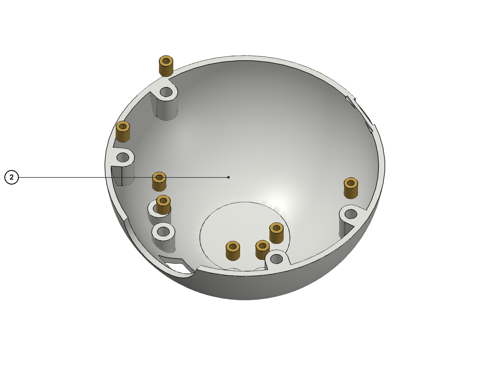

1. Press eight M3 heat-set inserts into the bowl with a soldering iron (about 230 °C for PETG): the four 6 mm ones into the bosses at the rim, the four 5 mm ones into the bosses low on the front wall, below the notch for the button. Push straight down and stop when the insert is flush with the top of its boss; let it cool before you touch it.
2. The four lower bosses take the screws of the grass tongue. Check from outside that an M3 screw passes freely through the hole below each of them.

### Step 2: Build the grass tongue

Parts: **3** Grass tongue (tray), **4** PN5180 NFC reader (blue board, 70 x 39 mm), **5** Hall switch, TO-92 (DRV5032FB or AH3661UA), **6** Reader harness: 6-pin plug-and-socket pair with wires, **7** Grass top (turf plate with its tufts), **8** Screw M2 x 6 (grass top to tray)

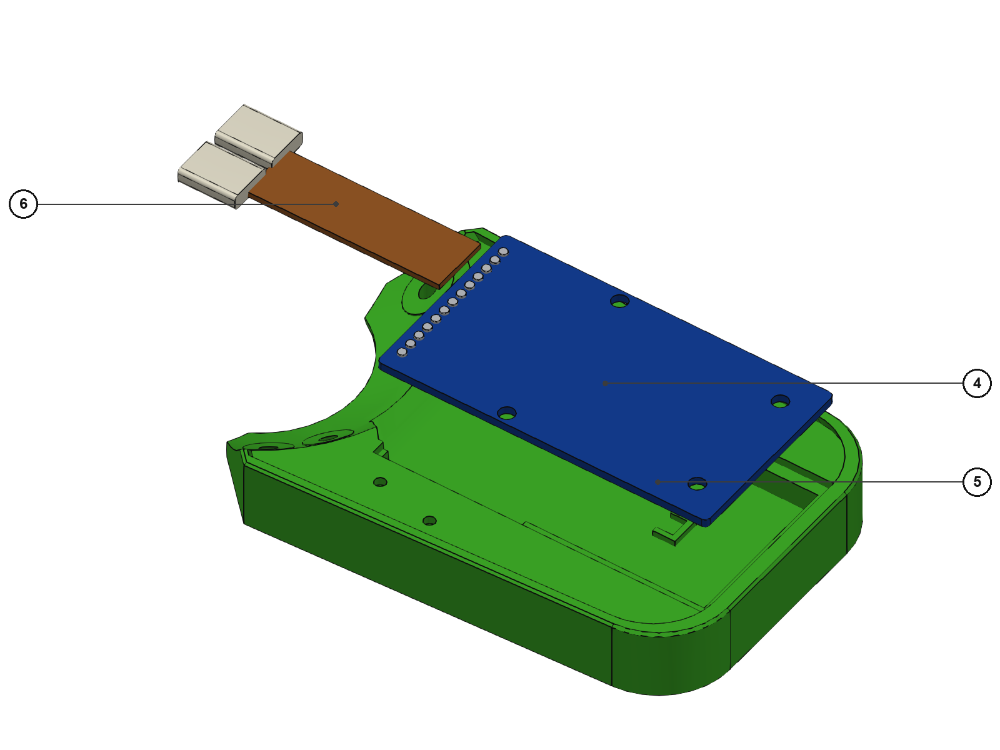

1. Wire the reader. Take the plug halves of the two 6-pin pairs with about 12 cm of wire. Solder ten wires to the reader's header row, coming from the component side: the first nine pads, +5V, +3.3V, RST, NSS, MOSI, MISO, SCK, BUSY, GND, and the pad IRQ. The pads GPIO, AUX and REQ stay empty. Cut flush whatever sticks out on the plain side. The header that comes with the board is not fitted: the plain side has to be flat.
2. Wire the hall switch. Its supply leg goes to the reader's +3.3V pad and its ground leg to GND, each with a short wire; its output leg takes the eleventh wire of the plugs. The twelfth wire stays free (table in `docs/electronics.md`). Insulate each joint with thin heat-shrink tube.
3. Glue the hall switch flat onto the floor of the pocket between the three small walls under the middle of the antenna, printed face up, legs pointing towards the ball. If the bench test of section 2 found the magnets of your figures elsewhere, glue it there instead; the floor is flat all over. Lay its wires along the floor.
4. Lay the reader into the pocket, components down, with the antenna at the tip of the tongue and the header end against the two stops at the rear. It rests on the ledge all round. Lead the wires side by side through the channel towards the ball and fix them there with a drop of hot glue. Two more drops at the corners keep the board from rattling.
5. Fit the grass top into its frame: hold it level, a little behind its place, and push it forwards and down, so that its bevelled front edge slips under the rim at the tip and the plate lies flush in the frame all round. Turn the tongue over and fasten the four M2 x 6 screws from below; their heads sit deep in the holes of the sole. The screws form their own thread in the roots of grass tufts in the two rear corners, so stop as soon as they are snug.

### Step 3: Screw the tongue under the bowl

Parts: **9** Screw M3 x 16 countersunk ISO 10642 (tongue to bowl)

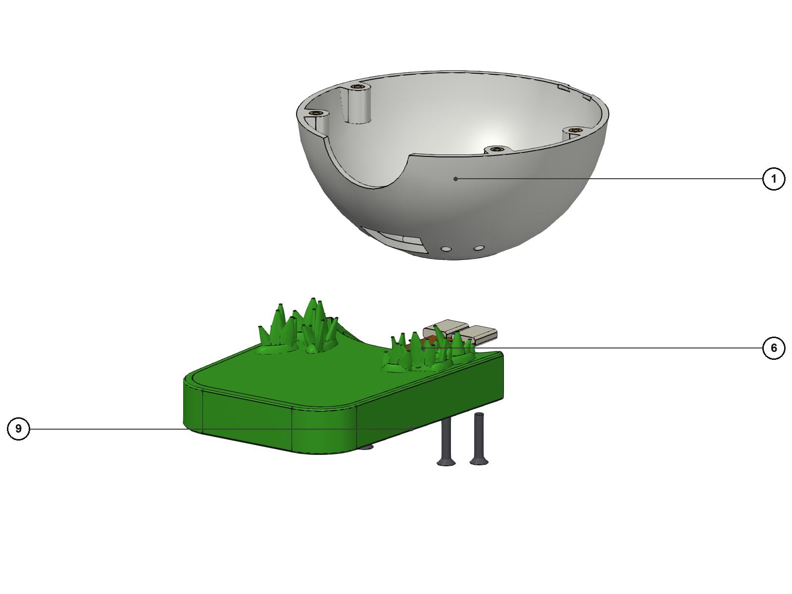

1. Push the two plugs of the reader harness from outside through the window low on the front of the bowl, one after the other, and pull the wires in after them.
2. Set the bowl onto the hollow rear end of the tongue, with the U-shaped notch for the button above the tongue. The bowl rests on four small pads round the screw holes; everywhere else a gap of 0.25 mm remains. No part of the tongue reaches round the ball. With the bowl in place the grass top can no longer slide back out of its frame.
3. Hold both together, turn them over and fasten the four countersunk M3 x 16 screws into the lower inserts. Tighten gently and in turn.
4. Stand the device on a flat table. The underside of the tongue lies in the plane of the ball's flat foot, so both stand on the table together and the device must not rock. Printed parts differ by a tenth of a millimetre or two: if it rocks, a strip of adhesive tape on the four pads lowers the tongue and a few strokes of sandpaper on them raise it. Three thin felt dots, one under the flat of the ball and two under the tongue, hide whatever remains.
5. Look into the gap between grass and ball at the front: no wire may be pinched under the bowl.
6. The other order works as well: finish and test the whole ball first, then pull the two sockets of the core out through the window, plug them in, push the pairs back and screw the tongue on. The window lets a mated pair pass.

### Step 4: Fit the boards and the battery contacts

Parts: **10** Chassis, **11** 18650 contact plates (+ dimple, - spring), **12** Seeed XIAO ESP32-S3 Plus, **13** MAX98357A I2S amplifier, **14** TP4056 USB-C charger with protection, **15** 5 V boost converter (Adafruit MiniBoost TPS61023)

1. Wire the electronics on the bench first, following `docs/electronics.md`, and test them before anything goes into the chassis.
2. Slide the two contact plates into the slots at the ends of the battery cradle: the spring at the right-hand end (-Y, cell minus), the dimple at the left-hand end (+Y, cell plus). Their solder tabs point up.
3. Lay the charger on its shelf at the back left, between the two lips, with the USB-C socket pointing outwards and the inner end of the board against the stop block. The stop takes the push of the plug; a bed of epoxy or hot glue under the board holds it against the pull when unplugging. Check with the band held in place that the face of the socket ends just behind the band's surface; adjust `TP_L` in `params.py` if your module is longer or shorter than 28 mm.
4. Stand the XIAO upright in its pocket on the right (USB-C up) and the amplifier upright in the pocket on the left (pin row up). Lay the boost converter on its small shelf behind the battery. A drop of hot glue per board is enough.
5. Plug the XIAO's flexible antenna into its U.FL socket and stick it to the inside of the chassis wall on the right, as far from the cell as the lead allows.
6. Lead the two 6-pin sockets for the reader harness down through the rectangular window in the floor plate, with about 8 cm of wire below the plate.

### Step 5: Fit the servo

Parts: **16** 9 g micro servo (SG90 class), **17** Servo horn (stock single arm) + screw, **18** Servo mounting screw 2 x 8 (supplied with servo)

1. Shorten the single-arm servo horn to 13 mm from the centre of the shaft with side cutters, and measure it: not longer. The arm passes the pivot of the pawl at less than a millimetre, and one that is too long strikes it.
2. Lower the servo into its bay with the output shaft towards the left (+Y) and the cable in the slot. Fix it with the two screws that came with it.
3. Do not fit the horn yet: its angle is set during commissioning (section 6).

### Step 6: Build the front module: speaker, light and bezel

Parts: **19** Speaker Visaton K 40 (8 ohm), **20** Speaker clamp ring, **21** Screw M2 x 8 (speaker clamp), **22** RGB LED WS2812B on 10 mm PCB, **23** Light cone, **24** Button lens, **25** Button bezel (black ring with sound slits)

1. Solder two wires to the speaker. Seat the speaker against the back of the baffle (cone to the front) and clamp it with the clamp ring and two M2 x 8 screws, which form their own thread in the baffle. Reach them from behind with the long arm of the 1.5 mm hex key, past the servo, and turn the key by its short arm. The solder tags sit in the notch of the ring. A thin bead of glue around the rim makes the front chamber airtight.
2. Push the lens into the bezel from behind until its flange sits on the step. Push the white light cone in behind it; it holds the lens in place.
3. Solder three wires to the LED board, press it into the cup at the narrow end of the cone (LED facing the lens) and lead the wires out through the notch.
4. Glue the bezel into the socket of the baffle. The key under the tube fits only one way; the four slits then lie on the diagonals. Lead the LED wires out of the front chamber through the socket key notch and seal the notch with a drop of glue.

### Step 7: Lower the core into the bowl and insert the cell

Parts: **26** 18650 Li-ion cell (unprotected flat top)

1. Hold the finished core over the bowl and join the two 6-pin plugs of the reader harness to the two sockets hanging under the chassis. Mark the pairs A and B so that they cannot be swapped.
2. Lower the core. The plugs and the spare wire fold into the space between the floor of the bowl and the chassis plate; the bezel slides into the U-shaped notch and the chassis flange comes to rest on the four bosses at the rim.
3. Snap the 18650 cell into the cradle, plus pole to the left (+Y), until the two side walls click over it.
4. If the charger's protection circuit stays off after a cell has been inserted, connect USB-C power once to wake it.

### Step 8: Fit the band

Parts: **27** Band (black equator ring)

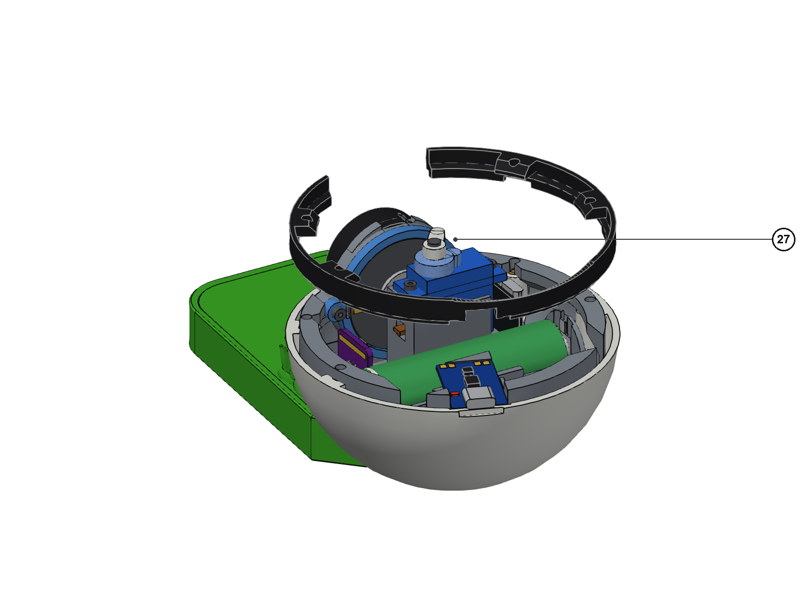

1. Lower the black band over the core. Its notch slips over the USB-C socket, its gap over the bezel, and its skirt drops inside the rim of the bowl. The four lugs lie on the chassis flange, over the screw holes.
2. Optional: glue a 6 mm wide strip of black felt or fabric tape to the inside of the band below the shallow pocket at the back, standing 2 mm proud of the pocket. It closes the view into the hinge and bends away when the lid opens.

### Step 9: Assemble the stage: latch and ring pawl

Parts: **28** Stage (inner dome with ring deck), **29** Latch pawl, **30** Pivot washer for the pawl, **31** Screw M2 x 6 (pawl pivot), **32** Compression spring about 4 x 12 (pawl return), **33** Ring pawl (lock of the ring), **34** Washer M3 and washer M2 (ring pawl pivot), **35** Screw M2 x 6 (ring pawl pivot), **36** Compression spring 4 x 15 (ring pawl return)

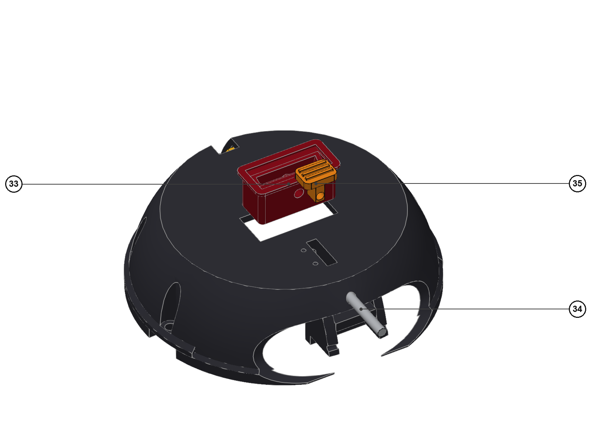

1. Turn the stage upside down. Put the pawl on the pivot boss (post pointing away from the deck) and turn it: it must swing without any friction and have a little play, 0.25 mm all round. A hole often comes out of the printer smaller than drawn; if the pawl is tight on the boss, scrape its bore with a knife or a drill of 5.5 mm held in the fingers. Then put on the printed pivot washer, flange towards the pawl, and the M2 x 6 screw. The screw forms its own thread in the boss: turn it in until the washer sits on the end of the boss, and no further. The pawl must still swing freely and be able to move 0.3 mm up and down between deck and washer; the washer only keeps it from slipping off.
2. Cut 12 mm off the ball-pen spring. Push one end into the cup that stands on the underside of the deck beside the pawl and set the other end over the nub on the pawl's tail. It pushes the tail against the stop pin.
3. Try the latch now, while you can see it. Push the nose of the pawl aside with a finger as far as it goes, about 54°, and let go, from several positions: each time it must snap back against its stop pin by itself. If it creeps or stops on the way, find out where it rubs before you go on; this is the part that has to let the lid go.
4. The ring pawl goes onto the second boss, at the end of the slot of the ring, in the same way as the latch pawl, with its knob towards the deck. Under the windows the walls of the slot are closed, so its finger cannot come down into its window: hold the pawl turned about 25° away, so that the end of the finger stands behind the wall of the slot, lower it onto the boss with the knob entering the far end of the curved slit, and let it turn back. The finger slides through the window and across the slot. The pawl must swing without friction and have a little play, like the latch pawl.
5. Slip an M2 washer and then an M3 washer onto an M2 x 6 screw and turn it into the boss until the washers sit on its end, and no further. The wide washer is what keeps the pawl on its boss: a standard M2 washer is 5 mm across, the bore of the pawl 5.5 mm. Pull at the pawl: it must not come off over the washers, and it must still swing freely and move 0.3 mm up and down between deck and washer.
6. Take a compression spring of 4 x 15 mm as it comes. Push one end into the cup that stands on the underside of the deck in front of the tail of the ring pawl and set the other end over the nub beside the knob. It turns the pawl until its arm lies against the pad on the wall of the slot, and the finger then lies across the slot.
7. Turn the stage over and try the lock. Pull the knob towards the middle line of the deck as far as it goes, and let go, from several positions: each time it must snap back by itself and the finger must cross the slot again. With the knob pulled 4 mm the slot is free. That takes a firm pull: the spring is pressed a good deal further than the one of the latch pawl. Windows and slit are 1 mm wider than finger and knob on each side; if the finger catches on the edge of a window, look for a blob or a thread of plastic there.

### Step 10: Hinge the lid to the stage

Parts: **37** Lid (red upper half), **38** Dowel pin 2 x 8 (hinge), **39** Spring sleeve, **40** Torsion spring T028-180-140 (0.71 x 6.32 mm, 6 turns, 180°), **41** Dowel pin 2 x 18 (seat of the spring leg)

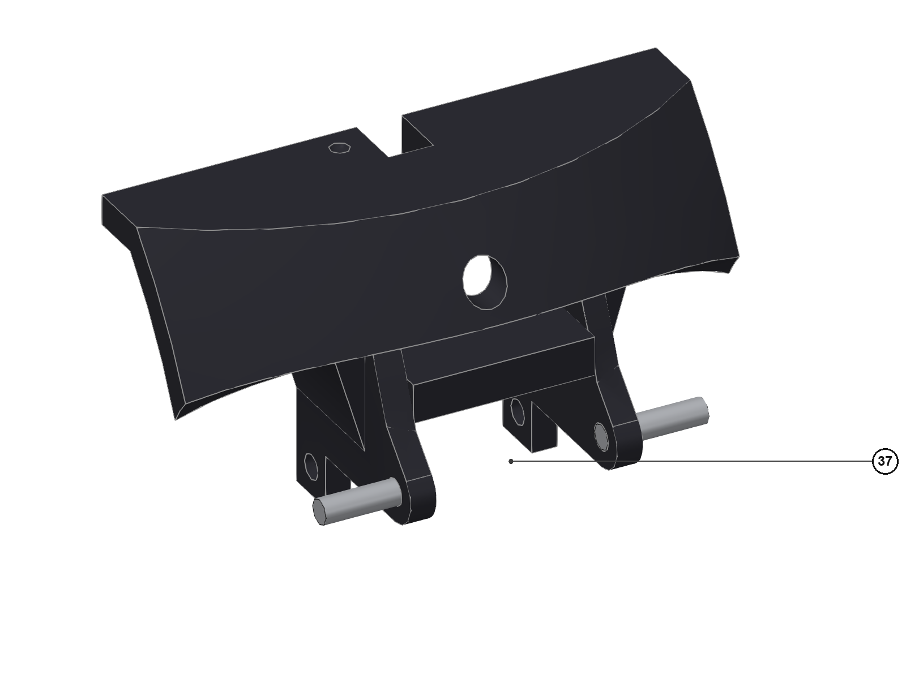

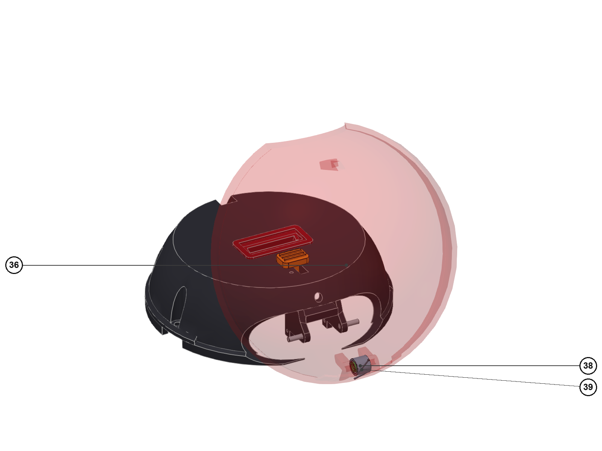

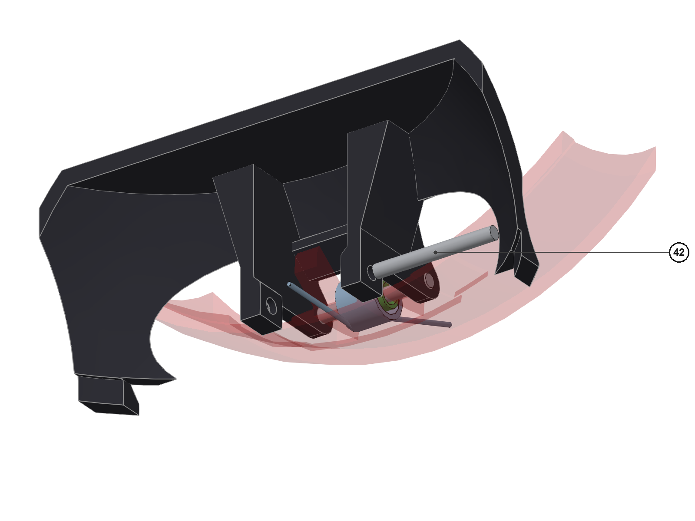

1. Prepare the small parts. Cut both legs of the torsion spring to 14 mm, measured from where they leave the coil, and take the burr off the cut ends. Lay the third pin, 2 x 18 mm, within reach.
2. Try the fits before anything is joined. A 2 mm pin must pass through the bore of each rib of the lid without force; these bores are 2.3 mm and may have come out smaller, and a 2 mm drill turned through by hand clears them. Take the sleeve whose holes were found to hold the pins (section 3), one in which no pin has been yet. It must drop into the gap between the two ribs and rattle a little along it; if it is as long as the gap or longer, rub one of its ends on sandpaper. The ribs of the lid must go between the two hinge towers with visible room on both sides (0.5 mm each).
3. Put one 2 x 8 mm pin into each hinge tower of the stage from outside until its tip is flush with the inner face of the tower. The pins slide in the towers: the push of a finger moves them, and they stay where they are left. If a pin is tight, open the bore of the tower with a 2 mm drill. Both pins now stand 6.0 mm out of their towers and wait there.
4. Slip the printed sleeve into the torsion spring and find out now which way round the spring goes. Lay it down so that both legs leave the coil at its underside, one pointing forwards and one backwards. Hold the forward leg and swing the rear leg up and over towards the front, as the closing lid will do: the coil must wind tighter. If it opens instead, turn the spring upside down. Either winding direction fits, because the hinge is the same on its left and its right. Once the pins are in, spring and sleeve can only be cut out.
5. Hold the spring between the two ribs of the lid so that one leg lies up along the inside of the back wall of the lid and the other leaves the lid over the inner edge of its rim.
6. Let the back of the stage stand out over the edge of the table, so that the leg of the spring has room below it. Hold the lid about 65° open behind the stage and slide it forwards until its two ribs lie between the hinge towers and their round ends line up with the round ends of the towers. The two waiting pins pass through the shallow channels inside the wall of the lid.
7. Push the pins in, one after the other, with a small flat screwdriver that comes from above and gets behind the end of the pin. After 3.9 mm a pin is through its rib and meets the end of the sleeve. Move the coil with a toothpick until the tip of the pin slips into the funnel of the sleeve. No force is needed so far. The lid now hangs on the two pins.
8. Open the lid as far as it goes. Put long-nose pliers over the hinge from above, one jaw on the end of each pin, and squeeze the pins towards each other until they stop. That takes firm pressure: each pin is pressed 1.35 mm into the sleeve and then stands on the bottom of its hole, its outer end about level with the outer face of the tower. The sleeve now holds both pins, and the ribs of the lid hold the sleeve.
9. Seat the spring. Its forward leg lies on the rim of the lid, just beside the two holes in the feet of the towers, on the side away from the deck. Hold the stage so that you look into it from below. Push the tip of the leg 3 mm towards the deck with the screwdriver and push the 2 x 18 mm pin from the side through the hole of one foot, past the leg and into the hole of the other foot, so that the leg lies between the pin and the deck. The holes hold the pin by a light press fit: push it with the flat of the screwdriver or with the pliers until it stands out of neither foot, and let the leg go. It now rests on the pin. Firm pressure is right, force is not: a hole that is too tight splits its foot along the layers of the print, and inside the stage no drill reaches these holes. The test piece for the pins shows beforehand whether they suit your printer (section 3). A pin that sits loosely gets a drop of glue at one end.
10. Close and open the lid by hand a few times. It must swing freely from closed to the end stop at about 95° and the spring must throw it open. When the lid is shut completely the latch catches it: push the post under the tail of the pawl aside from below, and the lid jumps open. That is what the servo will do.
11. Now try its play, because no printed hinge runs on one line. The front of the lid can be moved about 2 mm to either side and tilted a little; everything it passes is laid out for that. Open and close it slowly while you push its front to the left, then to the right, then while you press one side of it down. Nowhere may it catch or need force, and the hook must drop into its slot from each of these positions: the funnel round the slot leads it in. From about 8° of opening on it must touch nothing at all. If it rubs, look for a blob or a remnant of support on the rim of the lid, on the collar of the stage inside that rim, or in the slot.
12. One long pin cannot be used in this hinge: the wall of the lid closes the hinge axis at both ends. To take the lid off again, push the pin under the spring leg out sideways and cut through the coil of the spring and the sleeve inside it, between the ribs, with strong side cutters. The halves of the sleeve then come off the pins, and each pin can be pushed outwards with a small screwdriver until it has left the rib. Spring and sleeve are lost; fit new ones.

### Step 11: Screw the stage onto the core

Parts: **42** Screw M3 x 16 ISO 4762 (stack)

1. Open the lid. Lower the stage onto the core: its notch goes over the bezel, the pawl post drops in beside the servo, and the four screw wells line up with the band lugs. The stage must come to lie on the lugs by its own weight; if it rides on the bezel, the bezel sits too high in its socket.
2. Fasten the four M3 x 16 screws through the wells, and before you tighten them push the stage towards the button as far as it goes. They pass through stage, band lug and chassis flange into the inserts at the rim of the bowl and clamp the whole stack. Tighten gently.
3. Open and close the lid slowly by hand. Behind the hinge its rear rim dips into the shallow pocket of the band, with 0.4 mm of room; of all the gaps round the lid this is the smallest. If the rim scrapes there, undo the screws, push the stage further towards the button and try again; if it still scrapes, deepen the pocket by a few strokes with a knife or a file. The pocket is black and lies under the lid.

### Step 12: Seat and lock the ring, close the lid

Parts: **43** Engagement ring (EU 49)

1. Wrap the lower half of the ring in a strip of soft cloth or paper. Pull the knob, which stands to the front left of the slot, towards the middle line of the deck and hold it, push the ring with its wrapping into the slot until it sits on the bottom, and let the knob go: the finger of the ring pawl now passes through the ring below the deck. Fill what is left of the slot on both sides of the ring with more cloth or paper until the ring stands firm; keep it away from the middle, where the finger passes. The slot is 3.1 mm wide, 25 mm across and 13 mm deep, and under the finger it has 6.0 mm for the band of the ring and what lies under it.
2. Pull at the ring: it must not come out, however the ball is shaken or dropped. Then pull the knob once more and see that the ring lifts out and goes in again easily.
3. Before the lid is closed for the first time, lower it by hand and look at the gap round the black ring of the button and at the seam above the band: the lid must come down onto the band all round without being pressed, and a strip of paper must pass between the lid and the ring (the gap is 0.6 mm). A lid that has to be pressed into its seat would stay there when the latch lets go.
4. Check that the servo is in its rest position, then press the lid down until the latch clicks. Latched, the lid can be pressed down by a little less than a millimetre at the front and comes up again: the latch needs that room (0.75 mm), so that it also closes over a tooth that the printer has made a little too high.

## 6. Commissioning

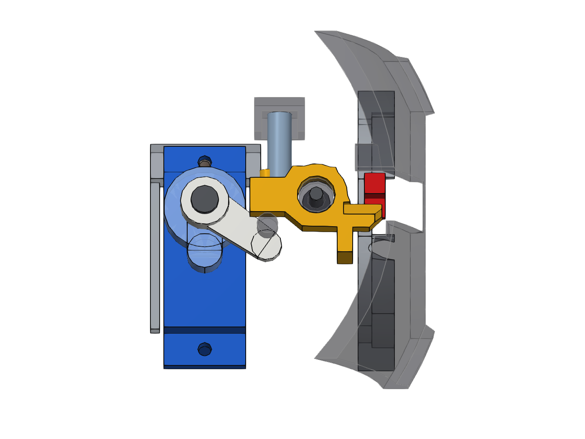

*The latch seen from above with the deck removed, locked. The pawl (yellow) lies over the tooth of the lid hook (red). The servo arm rests clear of the pawl's post.*

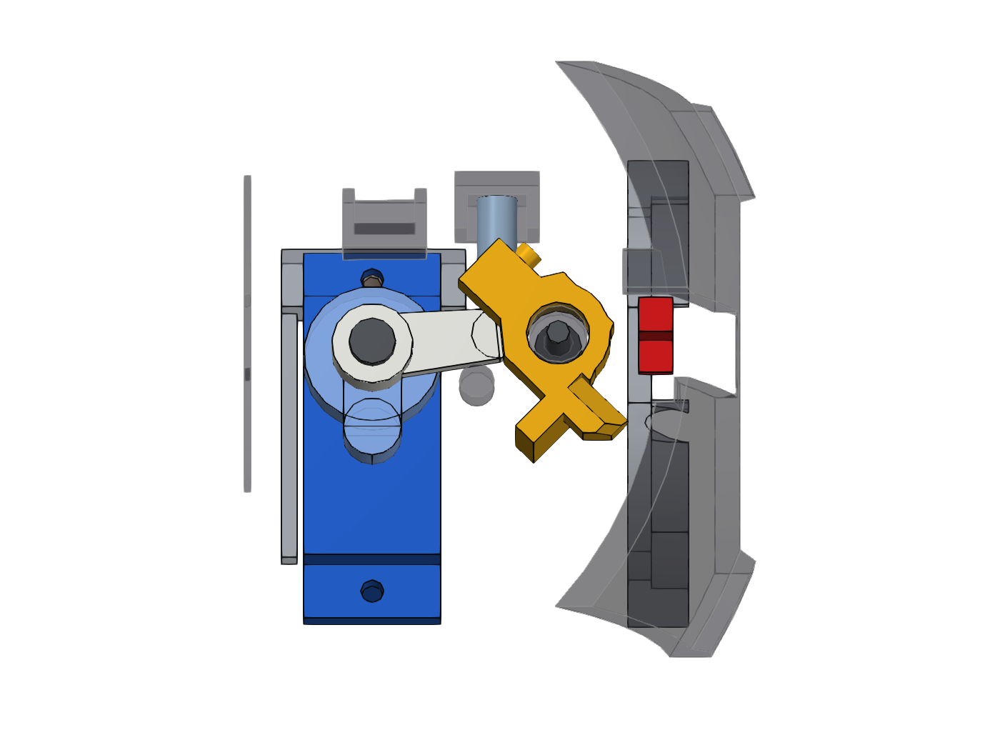

*Released: the servo arm has pushed the post, the pawl has turned and its nose has left the tooth.*

1. **Set the horn.** With the stage off and the servo commanded to its rest pulse, push the trimmed horn onto the shaft pointing about 35° to the right of straight ahead (towards -Y), and fit its screw. At the release pulse it should point about 6° to the left of straight ahead: it sweeps 41° and turns the pawl by about 44°. Store both pulse widths in the firmware; never command a position beyond them.
2. **Test the latch with the stage on and the lid open.** Look down into the slot of the hook. At rest the nose of the pawl shows in one half of the slot, the half on the right-hand side of the ball (-Y). Command release: the nose must swing out of sight, well beyond the edge of the slot, and the pawl must not yet stand against anything: it could turn 10° further. A servo that stops a few degrees short still frees the hook; one that leaves part of the nose visible in the slot does not turn far enough. Command rest: the pawl must return against its stop pin by its own spring.
3. **Test the opening.** Close the lid (press until it clicks) and command release. The lid must open fully. Repeat twenty times, and half of these times close the lid carelessly: pushed to one side, or pressed down at one edge only. It must latch and open all the same. Then tilt the device about 30° to the left and to the right and release it once in each position: the lid then hangs to one side in its hinge.
4. **Test the emergency opening** described below, so that you know the feel of it.
5. **Test the tongue.** Stand each figure at the front end, its foot about 2 mm short of the front edge: the ball must wake and read it, also when the figure stands 8 mm further back or to one side. Leave a figure standing: the ball must go back to sleep and stay asleep.
6. **Register the four Tonies and upload the messages** once the firmware exists.

## 7. Using the ball

### Presenting a Tonie

| | |
| --- | --- |
| 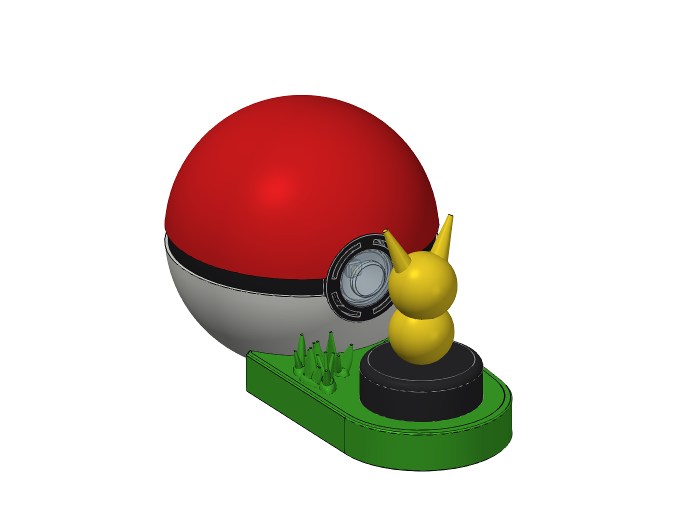 |  |

Stand the device on a table or on the ground and stand the Tonie at the front end of the tongue, in the middle between its two sides: its foot then ends about 2 mm short of the front edge and leaves about 10 mm on each side. That wakes the ball. No mark shows the place; the front end is the cue. The reader's antenna lies 1.7 to 3.3 mm below the surface, centred under that place; the tag itself is a small rod further up inside the figure.

Nothing holds the figure. It stands on a plain, level surface without recess or catch. The thin line that runs round the front end is the joint between the grass top and the rim of the tray; both are level, and the front edge of the foot stands on the rim. The grass stands only in the two corners beside the ball, in tufts of different sizes thrown at random; the sides and the front of the figure are open. Whoever carries the device has to hold the figure separately, as on any tray. On a shelf the figure simply stands on the tongue; the firmware lets the ball sleep while a figure stays there.

### Charging

The USB-C socket sits in the black band at the back, 20° to the left of the hinge. The shallow scoop in the white rim below it makes room for the body of the plug. A charge at 0.5 A takes about 7 hours. Do not run the hunt from the charger: the charger has no power path and will not terminate while the ball is active.

### Emergency opening

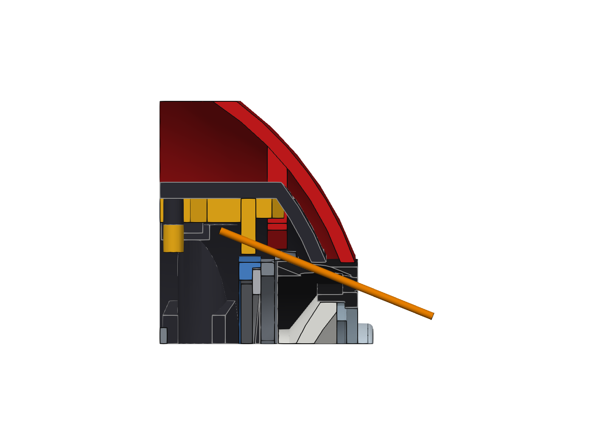

*Section along the path of the paper clip (orange).*

If the electronics fail, the lid can still be opened without leaving a mark. Straighten a paper clip (wire up to 1.2 mm). Looking at the button, insert it into the **upper left slit**, near the upper end of that slit, about 6 mm left of the vertical centre line. Aim 22° upwards. After about 16 mm the clip meets resistance; push it on, about 5 mm, until the lid springs open. The clip leaves the bezel through a slot in its wall and pushes the pawl aside. Nothing on the outside shows that this is possible.

### Closing the lid

Press the lid down until the latch clicks. The tooth of the hook pushes the pawl aside by itself; the servo is not needed.

### Releasing the ring

| Locked | Released |
| --- | --- |
| 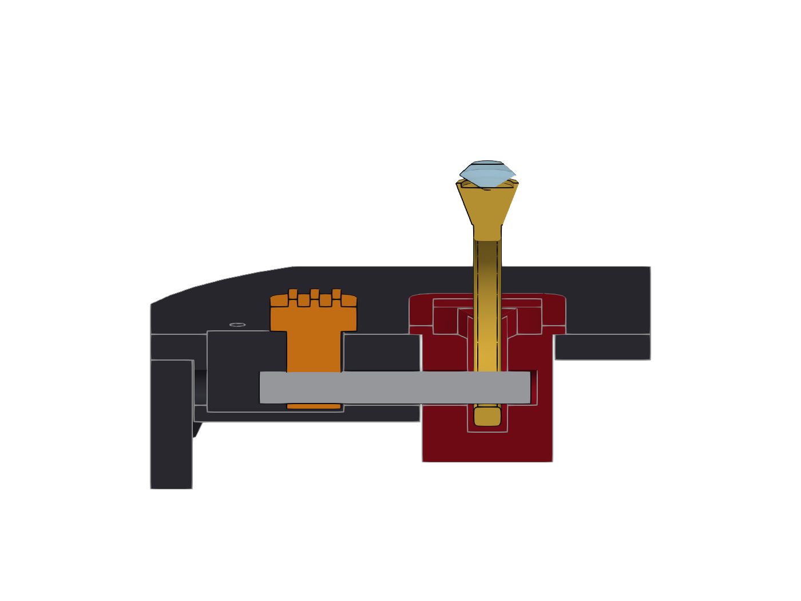 |  |

*The ring in its slot, seen from behind and above. The finger of the ring pawl is seen inside the ring, in its middle. The knob stands in its curved slit to the front left of the ring.*

Pull the knob towards the middle line of the deck by 4 mm and hold it. The finger leaves the ring and the ring lifts out with its wrapping. Let the knob go: a spring takes it back. Nothing but a hand moves this lock.

| From below | Section along the finger |
| --- | --- |
| 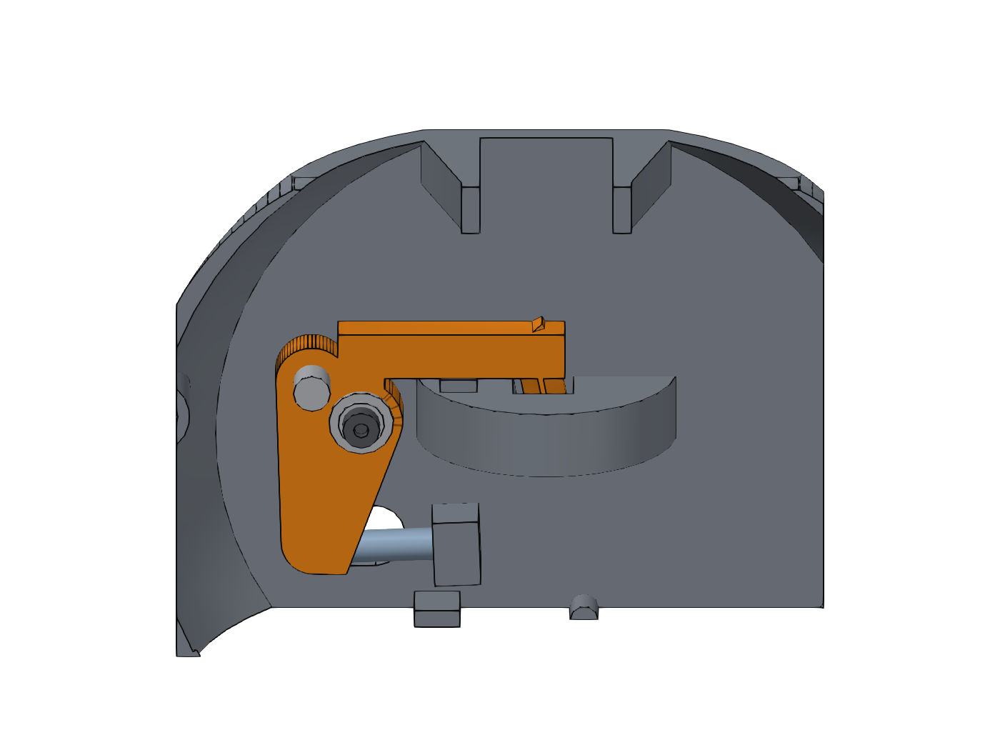 | 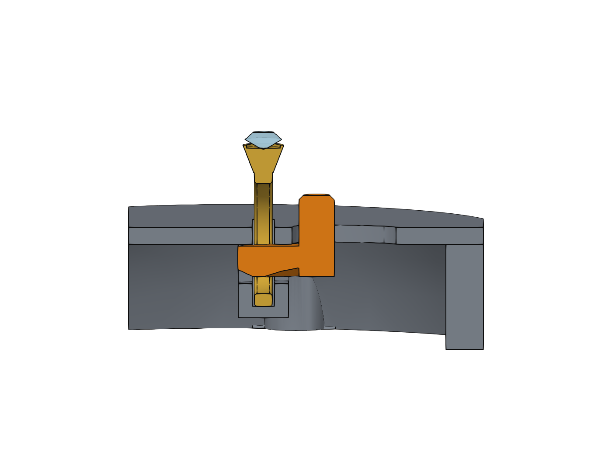 |

*Left: the ring pawl under the deck with its pivot screw, the spring in its cup and the pad on the wall of the slot on which the arm rests. Right: the finger passes through the ring 6.0 mm above the bottom of the slot and lies under the deck on both sides of it, so a pull at the ring presses it against the deck.*

### The hinge

| Closed | Open |
| --- | --- |
|  | 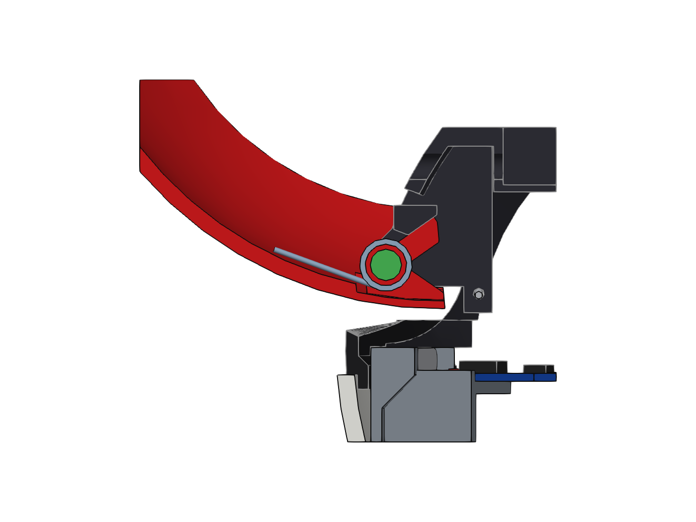 |

The hinge lies inside the lid, on two short pins in the towers of the stage. While the lid opens, its rear rim dips into a shallow pocket in the top edge of the black band. That pocket is the only trace of the hinge on the outside; it is black, lies under the overhanging lid and can be closed with the felt strip from step 8.

## 8. Service

**Swapping the cell**

1. Open the lid (by command or with the paper clip) and unlock and remove the ring.
2. Undo the four M3 screws in the wells of the stage and lift the stage with the lid straight up.
3. Lever the cell out of its cradle and snap in a charged one, plus pole to the left.
4. Put the stage back and fasten the four screws.

To take out the whole core, also lift off the band and separate the two 6-pin plugs under the chassis.

**Opening the grass tongue**

1. Undo the four countersunk screws under the rear end of the tongue and lift the ball a few centimetres off it.
2. Pull the two plug pairs out through the window in the bowl and separate them. The ball is now free.
3. Undo the four small screws, lift the rear of the grass top a little and draw it backwards out from under the rim at the tip; the reader lies open.

## 9. Exploded view

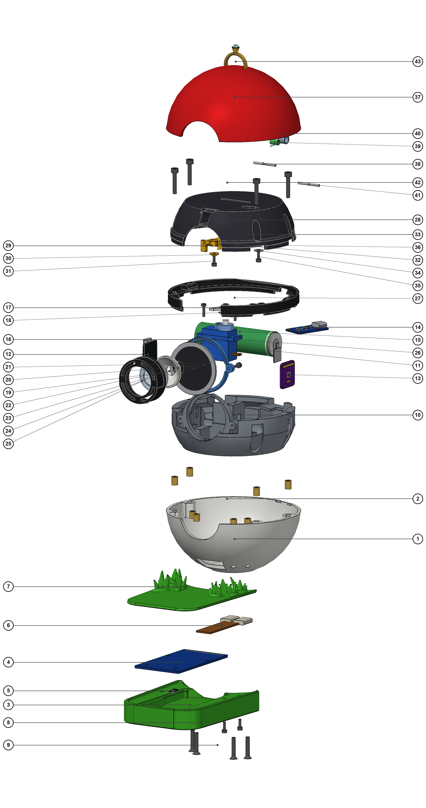

| Pos. | Part | Qty | Kind |
| --- | --- | --- | --- |
| 1 | Bowl (white lower half) | 1 | printed |
| 2 | Heat-set insert M3, Ø5 (four x 6 mm, four x 5 mm) | 8 | hardware |
| 3 | Grass tongue (tray) | 1 | printed |
| 4 | PN5180 NFC reader (blue board, 70 x 39 mm) | 1 | purchased |
| 5 | Hall switch, TO-92 (DRV5032FB or AH3661UA) | 1 | purchased |
| 6 | Reader harness: 6-pin plug-and-socket pair with wires | 2 | purchased |
| 7 | Grass top (turf plate with its tufts) | 1 | printed |
| 8 | Screw M2 x 6 (grass top to tray) | 4 | hardware |
| 9 | Screw M3 x 16 countersunk ISO 10642 (tongue to bowl) | 4 | hardware |
| 10 | Chassis | 1 | printed |
| 11 | 18650 contact plates (+ dimple, - spring) | 2 | purchased |
| 12 | Seeed XIAO ESP32-S3 Plus | 1 | purchased |
| 13 | MAX98357A I2S amplifier | 1 | purchased |
| 14 | TP4056 USB-C charger with protection | 1 | purchased |
| 15 | 5 V boost converter (Adafruit MiniBoost TPS61023) | 1 | purchased |
| 16 | 9 g micro servo (SG90 class) | 1 | purchased |
| 17 | Servo horn (stock single arm) + screw | 1 | purchased |
| 18 | Servo mounting screw 2 x 8 (supplied with servo) | 2 | hardware |
| 19 | Speaker Visaton K 40 (8 ohm) | 1 | purchased |
| 20 | Speaker clamp ring | 1 | printed |
| 21 | Screw M2 x 8 (speaker clamp) | 2 | hardware |
| 22 | RGB LED WS2812B on 10 mm PCB | 1 | purchased |
| 23 | Light cone | 1 | printed |
| 24 | Button lens | 1 | printed |
| 25 | Button bezel (black ring with sound slits) | 1 | printed |
| 26 | 18650 Li-ion cell (unprotected flat top) | 1 | purchased |
| 27 | Band (black equator ring) | 1 | printed |
| 28 | Stage (inner dome with ring deck) | 1 | printed |
| 29 | Latch pawl | 1 | printed |
| 30 | Pivot washer for the pawl | 1 | printed |
| 31 | Screw M2 x 6 (pawl pivot) | 1 | hardware |
| 32 | Compression spring about 4 x 12 (pawl return) | 1 | hardware |
| 33 | Ring pawl (lock of the ring) | 1 | printed |
| 34 | Washer M3 and washer M2 (ring pawl pivot) | 2 | hardware |
| 35 | Screw M2 x 6 (ring pawl pivot) | 1 | hardware |
| 36 | Compression spring 4 x 15 (ring pawl return) | 1 | hardware |
| 37 | Lid (red upper half) | 1 | printed |
| 38 | Dowel pin 2 x 8 (hinge) | 2 | hardware |
| 39 | Spring sleeve | 1 | printed |
| 40 | Torsion spring T028-180-140 (0.71 x 6.32 mm, 6 turns, 180°) | 1 | purchased |
| 41 | Dowel pin 2 x 18 (seat of the spring leg) | 1 | hardware |
| 42 | Screw M3 x 16 ISO 4762 (stack) | 4 | hardware |
| 43 | Engagement ring (EU 49) | 1 | purchased |

