# Building manual: Poké Ball in the tall grass, for the Tonie hunt

This manual is generated by `uv run poketonieengagementhunt manual` from the CAD model in `src/poketonieengagementhunt/`. Pictures, part numbers and dimensions therefore always match the model. The balloons in every picture carry the position numbers of the bill of materials in section 1.

| Closed | With a Tonie | Open |
| --- | --- | --- |
|  | 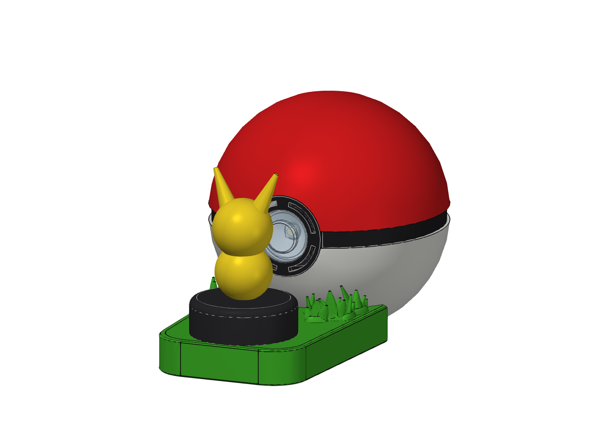 | 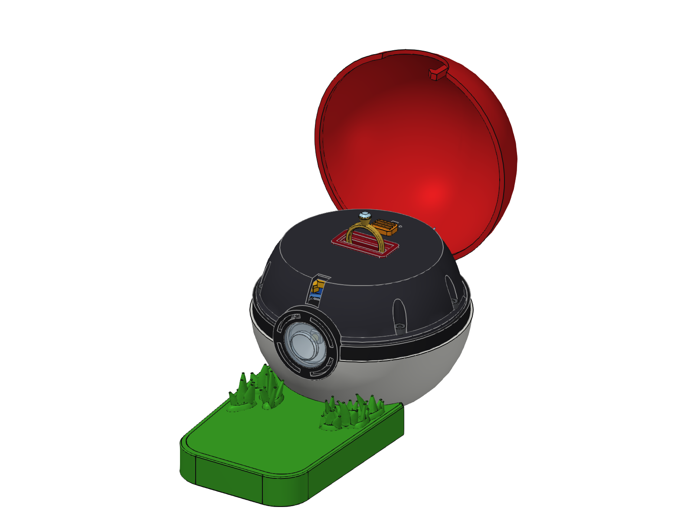 |

## What you are building

A 100 mm Poké Ball with a tongue of tall grass in front of it. The tongue is a block screwed under the lower front of the ball: 72 mm wide at the ball, 66 mm beside a figure, 15 mm high without the blades, and it reaches 61.5 mm beyond the ball, just past the reader board inside it. Tongue and grass are one light green. Nothing of the tongue lies beside or behind the ball, and its underside lies in the plane of the ball's flat foot, so ball and tongue stand on the table together. A Tonie is stood at the front end of the tongue, in front of the ball. That wakes the ball, which reads the figure's RFID tag and plays that figure's recorded message from its own flash memory. Because the figure stands on the grass, the ball always stays upright.

The ball's black front ring carries the sound slits and its button is a lens lit by an RGB LED. The red half is a spring-loaded lid on a concealed hinge. A servo releases its latch on command from the phone, and the lid jumps open to present the ring, which is locked into its seat by a steel pin.

*Section through the centre plane, seen from the right-hand side. Front (button and tongue) is on the right.*

Before you start: read `research/README.md` for why each part was chosen, `docs/electronics.md` for the wiring, and `docs/verification.md` for what has and has not been verified. The firmware and the phone app are not part of this manual.

**Safety.** A bare 18650 cell can deliver dangerous currents: never short it, never solder on it, and do not leave the ball in a hot car (PETG softens near 70 °C). The heat-set inserts are pressed in at about 230 °C. No magnets are used in the device. The only magnets involved are those inside the Tonies.

## 1. Bill of materials

### Purchased components

| Pos. | Qty | Part | What to buy | Research |
| --- | --- | --- | --- | --- |
| 4 | 1 | PN5180 NFC reader (blue board, 70 x 39 mm) | The common blue PN5180 module, about 70 x 39 mm, silkscreen "PN5180-NFC" (AliExpress, Amazon, eBay, AZ-Delivery). Prefer a listing whose pin header is supplied loose. The bag usually holds two test tags as well. | research/02 §1A, 08 |
| 5 | 1 | Hall switch, TO-92 (DRV5032FB or AH3661UA) | TI DRV5032FB hall switch in TO-92 (4.0 x 3.15 x 1.52 mm). If it cannot be had: AH3661UA in the same package (Conrad order number 1569221, TRU COMPONENTS), which needs a 1 MOhm pull-up resistor; see `docs/electronics.md`. Buy three or four: fit the one that answers to a magnet from furthest away, and keep one for the spare wire in case one switch does not catch the magnets. | research/04 §5, 09 §7, 10 C5 |
| 6 | 2 | Reader harness: 6-pin plug-and-socket pair with wires | Two pre-wired 6-pin wire-to-wire pairs with 1.25 mm pitch and at least 15 cm of 28 AWG wire on each half. Sold as "Micro JST 1.25 mm 6-pin male and female with wire"; the original parts are Molex PicoBlade 51021-0600 and 51047-0600. One half goes to reader and hall switch, the other to the core. | research/10 C1 |
| 11 | 2 | 18650 contact plates (+ dimple, - spring) | One spring and one button contact plate for AA/18650 holders, about 10 x 10 mm. | research/05 §3.2 |
| 12 | 1 | Seeed XIAO ESP32-S3 Plus | Seeed XIAO ESP32-S3 Plus (16 MB flash, 8 MB PSRAM) with its U.FL antenna. Fallback: Unexpected Maker TinyS3 (needs a longer pocket). | research/04 §1, 07 §11 |
| 13 | 1 | MAX98357A I2S amplifier | MAX98357A I2S class-D amplifier breakout (Adafruit #3006 or clone), terminal block not fitted. | research/04 §2 |
| 14 | 1 | TP4056 USB-C charger with protection | TP4056 USB-C charger module with DW01A protection, 28 x 17 mm. Change R_PROG to 2.0-2.4 kOhm for about 0.5 A. | research/05 §4.1 |
| 15 | 1 | 5 V boost converter (Adafruit MiniBoost TPS61023) | Adafruit MiniBoost 5V @ 1A (TPS61023), #4654, with enable pin. | research/05 §4.3 |
| 16 | 1 | 9 g micro servo (SG90 class) | Any SG90-class 9 g micro servo with its horns and screws. | research/05 §1 |
| 17 | 1 | Servo horn (stock single arm) + screw | The single-arm horn from the servo bag, trimmed to 13 mm. | research/05 §1.3 |
| 19 | 1 | Speaker Visaton K 40 (8 ohm) | Visaton K 40, 8 ohm, art. no. 2840 (Ø40 x 4.3 mm, 83 dB). | research/04 §3 |
| 22 | 1 | RGB LED WS2812B on 10 mm PCB | One WS2812B or SK6812 on a round Ø10 mm mini PCB. | research/04 §4 |
| 26 | 1 | 18650 Li-ion cell (unprotected flat top) | Unprotected flat-top 18650, e.g. Samsung INR18650-35E or Molicel M35A. | research/05 §2 |
| 39 | 1 | Torsion spring Gutekunst T-16324 (0.7 x 6.7, 7 coils) | Gutekunst T-16324L and T-16324R (order one of each). | research/06 §2.1 |
| 41 | 1 | Engagement ring (EU 49) | The engagement ring. Measure it and adjust the RING_* values in `params.py`, then reprint the cradle. | research/06 §1 |

### Hardware

| Pos. | Qty | Part | Note | Research |
| --- | --- | --- | --- | --- |
| 2 | 8 | Heat-set insert M3 x 5.7 | M3 heat-set inserts, Ø4.6 x 5.7 mm (ruthex / CNC Kitchen). | research/06 §4.1 |
| 8 | 4 | Screw M2 x 6 (grass top to tray) | M2 x 6 machine screws with a cylindrical head and hex socket, ISO 4762 / DIN 912. Any head up to Ø4.0 x 2.0 mm fits; a countersunk head does not. They form their own thread in the printed pilot holes. | research/06 §4.2, §4.3 |
| 9 | 4 | Screw M3 x 16 countersunk ISO 10642 (tongue to bowl) | M3 x 16 countersunk screws with hexagon socket, ISO 10642 or DIN 7991. | research/10 C2 |
| 18 | 2 | Servo mounting screw 2 x 8 (supplied with servo) | Supplied with the servo. | research/05 §8.1 |
| 21 | 2 | Screw M2 x 8 (speaker clamp) | M2 x 8 machine screws with a cylindrical head and hex socket, ISO 4762 / DIN 912. It has to be a hex socket here: the two screws lie deep in the core, where only a hex key reaches them. | research/06 §4.2, §4.3 |
| 31 | 1 | Screw M2 x 6 (pawl pivot) | M2 x 6 machine screw, the same as for the grass top. The washer under it is printed. | research/06 §4.2, §4.3 |
| 32 | 1 | Compression spring 3.5 x 8 (pawl return) | Soft compression spring about Ø3.5-4.5 x 8 mm, for example a piece of a ball-pen spring. | research/06 §2.2 |
| 34 | 1 | Dowel pin 3 x 25 (ring lock) | Steel dowel pin (parallel pin) Ø3 x 25 mm. A 24 mm pin of the ISO 2338 series fits as well; a 20 mm pin is too short: only half as much of it would sit in the slider. | research/06 §3 |
| 37 | 2 | Dowel pin 2 x 8 (hinge) | Two steel dowel pins (parallel pins) Ø2 x 8 mm, ISO 2338 / DIN 7 or hardened ISO 8734 / DIN 6325. Two pieces of a 2 mm bicycle spoke, 8 mm long with rounded ends, do as well. | research/06 §3 |
| 40 | 4 | Screw M3 x 16 ISO 4762 (stack) | M3 x 16 socket head cap screws, ISO 4762. | research/06 §4.3 |

### Small parts without a position number

| Part | Qty | Used for |
| --- | --- | --- |
| Electrolytic capacitor 470-1000 µF / 10 V | 1 | across the 5 V output of the boost converter, close to the servo |
| Resistors 2 MOhm and 1 MOhm, capacitor 100 nF | 1 each | battery voltage divider at the ADC pin |
| Resistors 100 kOhm | 3 | pull-downs on boost enable, amplifier SD and reader RST |
| Resistor 1 MOhm, capacitor 100 nF | 1 each, only with the AH3661UA hall switch | pull-up from the wake pad to 3.3 V at the controller; capacitor across the supply legs of the switch |
| Diode 1N4148 | 1 | in series with the LED's 5 V supply, so that 3.3 V data is in spec |
| Silicone wire 26-28 AWG, heat-shrink tube |  | all point-to-point wiring |
| Self-adhesive felt or velour, 0.5-1 mm |  | ring slot lining; optional curtain behind the band pocket; optional dots under the ball's flat and the tongue |
| Hot glue or epoxy; cyanoacrylate |  | boards, bezel, hall switch, reader |
| Flexible ferrite sheet 0.1-0.2 mm, about 45 x 42 mm (Würth WE-FSFS 364004 or 364005) | 1, only if needed | on the floor of the pocket under the antenna, if the bench test fails on a metal surface |
| Schottky diodes BAT43 or 1N5817 | 2, only if needed | supply of the reader in sleep, if the ball is woken by card detection instead of the hall switch |

### Printed parts

| Pos. | Part | File | Filament | Mass | Print orientation |
| --- | --- | --- | --- | --- | --- |
| 1 | Bowl (white lower half) | `export/stl/bowl.stl` | PETG white | 41 g | rim on the bed (dome up), tree supports inside only |
| 3 | Grass tongue (tray) | `export/stl/grass_base.stl` | PETG light green | 78 g | sole on the bed, no supports |
| 7 | Grass top (turf plate with its tufts) | `export/stl/grass_top.stl` | PETG light green | 13 g | underside on the bed, tufts up, no supports |
| 10 | Chassis | `export/stl/chassis.stl` | PETG any colour | 52 g | plate on the bed, supports under the baffle disc and shelf |
| 20 | Speaker clamp ring | `export/stl/spk_clamp.stl` | PETG any colour | 1.1 g | flat on the bed |
| 23 | Light cone | `export/stl/cone.stl` | PETG white | 1.4 g | large end on the bed |
| 24 | Button lens | `export/stl/lens.stl` | PETG natural / clear | 1.5 g | flange on the bed, button up, 100 % infill |
| 25 | Button bezel (black ring with sound slits) | `export/stl/bezel.stl` | PETG black | 3.4 g | face down on the bed, no supports |
| 27 | Band (black equator ring) | `export/stl/band.stl` | PETG black | 5.9 g | upside down: lid seat on the bed, no supports |
| 28 | Stage (inner dome with ring deck) | `export/stl/stage.stl` | PETG black | 31 g | upside down: deck on the bed, supports for the hinge yoke only |
| 29 | Latch pawl | `export/stl/pawl.stl` | PETG any colour | 0.5 g | upside down: top face on the bed |
| 30 | Pivot washer for the pawl | `export/stl/pawl_cap.stl` | PETG any colour | 0.0 g | flange on the bed, hub up; 100 % infill |
| 33 | Ring cradle | `export/stl/cradle.stl` | PETG red or black | 4.1 g | as assembled, no supports |
| 35 | Ring lock slider | `export/stl/slider.stl` | PETG any colour | 0.4 g | cap on the bed (upside down) |
| 36 | Lid (red upper half) | `export/stl/lid.stl` | PETG red | 35 g | rim on the bed (dome up), supports inside only (hook, pole) |
| 38 | Spring sleeve | `export/stl/sleeve.stl` | PETG any colour | 0.1 g | standing on one end |

### Tools

- FDM printer with a 0.4 mm nozzle; PETG in red, white, black, natural (clear) and a light green, and any colour for the inner parts
- Soldering iron with a fine tip (also used to set the heat-set inserts)
- Hex keys 1.5, 2 and 2.5 mm, long-nose pliers, small cross-head screwdriver, side cutters, tweezers
- Drill bits of 1.7 or 1.8 mm and of 2.0 mm, only if a pilot hole for an M2 screw or the bore for a hinge pin prints too tight
- Multimeter; a USB-C cable and charger
- Calipers, to measure the ring, the reader board and the other delivered boards

## 2. Test on the bench before you print

Five things decide whether the design works, and none of them can be proven by CAD. Test them with loose parts and the real figures first:

1. **Tonie reading.** Wire the PN5180 board to the XIAO and flash any firmware that performs the SLIX-L privacy unlock (see `research/01` and `research/07`). Lay the board on a wooden table with the components down, on two strips of cardboard about 2 mm thick, as it will lie in the tray. Cover it with a sheet of plastic 1.6 mm thick and stand each of the four figures on the middle of the antenna. All four must read. The tag is a small upright rod somewhere inside the figure, perhaps several centimetres up, so find the reserve: raise each figure on books or coasters until it stops reading, and slide it sideways until it stops reading. Note both distances and which privacy password each figure needs.
2. **Metal under the tongue.** Repeat test 1 with a baking tray 12 mm under the board: that is a metal table under the tongue. The distance is a little more than the 10 mm that the antenna guides ask for [research/08 §8], so the figures should still read. If they do not, lay the ferrite sheet from the list of small parts 5 mm under the board, where the floor of the pocket will be, and repeat on both surfaces.
3. **The magnets.** The pocket is laid out for the magnets of the classic Tonies, which the Pokémon figures should share because they work on the first Toniebox: cylinders of 6 x 6 mm, one in the middle of the foot or one in each of two feet [research/09 §7]. Find them with a steel pin or a compass needle. Then fix the hall switch under the middle of the antenna with its printed face 5 mm below the plastic sheet (a stack of cardboard does it): that is where it lies in the tongue. It must switch when a figure stands on the sheet, in every rotation of the figure, and release when the figure is lifted away. Then slide the figure off the middle and note how far it can stand off before the switch lets go and before the read fails. Nothing marks the place on the tongue, so this distance is the reserve for a figure that is put down by eye; about 8 mm is what the layout counts on. If the switch does not answer at all, read "Wake, if the magnet is not where the switch is" in `docs/electronics.md` before you go on.
4. **Servo and supply.** Run the servo from the boost converter on the real cell while the amplifier plays. The board must not reset. Measure the stall current.
5. **Lid spring and hinge pins.** Print the lid, the stage and the band first. Try a hinge pin in a tower: it must go in under firm pressure and then sit fast (step 10). Hinge the lid and check that the spring throws it open and that it rests on the end stop.

Also measure the delivered parts against the values marked `MEASURE` in `params.py`: outline of the reader board (69.6 x 38.6 mm assumed; it sets the length of the tongue) and position of its antenna, the foot of a figure (45 mm assumed; the width of the tongue follows it), height of the XIAO, length of the charger and position of its USB-C socket, and the ring itself.

## 3. Print the parts

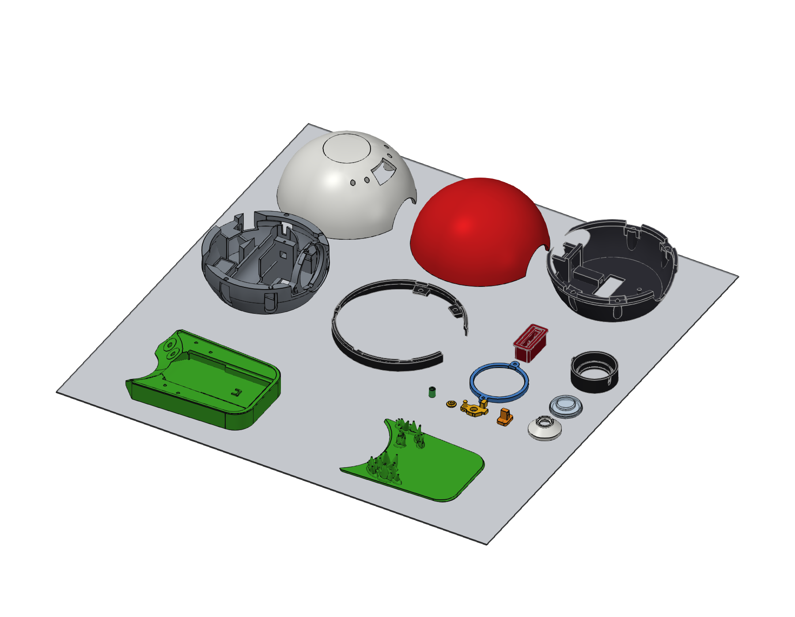

*All printed parts in their print orientation. The STL files in `export/stl/` are already turned this way.*

- Material: PETG for every part. The hinge, the latch and the spring seats stay under load for weeks, and PLA creeps and softens at 55-60 °C.
- 0.2 mm layers, 5 perimeters for the shells (they print solid), 4 perimeters and 30 % infill for the inner parts, 100 % for pawl, slider, sleeve and lens.
- Bowl, lid: rim on the bed, tree supports inside only. Put the layer seam at the back. A variable layer height (0.1 mm near the pole) hides the stair-stepping on the cap.
- Band, stage: upside down. Their 45° surfaces are designed to print without support in this orientation.
- Lens: natural (uncoloured) PETG. Print one first and check the glow with the LED; 1.6 mm front thickness is `LENS_T` in `params.py`.
- Bowl: the four bosses low on its front wall hang from the dome in print orientation. The tree supports that the floor needs anyway carry them.
- Grass tongue (tray): light green, sole on the bed, no supports, 4 perimeters, 40 % infill. The rim round its top overhangs inwards at the tip by less than 40°; it prints without support.
- Grass top: the same light green, one file (`grass_top.stl`): underside on the bed, tufts up, no supports, 5 perimeters so that the blades print solid. Slow down above the turf surface and keep a minimum layer time of about 8 s, so that the blunt tips do not melt. Its edge leans like the walls of its frame, and its lowest 0.3 mm stand back a little for a first layer that is squeezed wide. If it still does not drop into the frame, scrape its bottom edge with a knife.
- A green that comes close to the grass of the games: Bambu PETG HF Green [research/10 A.4]. Tray and grass top should come from the same spool.
- Print pawl, pivot washer, slider, sleeve and cradle first. They are small and show whether your printer's clearances suit: the slider must move in the stage with light friction and the pawl must turn freely on its boss.
- M2 pilot holes. The seven M2 screws form their own thread in printed holes: 1.95 mm where the mouth of the hole lies parallel to the print bed (grass top, stage) and 1.7 mm where it lies in an upright wall (chassis) [research/06 §4.2]. How such small holes come out depends on printer and filament, so print `export/stl/m2_test_coupon.stl` first, flat as it comes, in the PETG you will use. It has three holes from the top (1.85, 1.95, 2.05 mm) and three through its side (1.60, 1.70, 1.80 mm), the smallest of each three next to the cut-off corner. An M2 screw should turn into the middle one with light, even resistance and then hold firmly. If a neighbour fits better, change `M2_PILOT_FLAT` or `M2_PILOT_SIDE` in `params.py` and export again. A hole that is only a little tight can be opened with a 1.7 or 1.8 mm drill.

## 4. Wire the electronics

Wire and test everything on the bench, outside the ball, following the net list and the pin map in `docs/electronics.md`. Keep every lead just long enough to reach its place in the chassis plus 3 cm, and lead no wire across the top of the cell, which must lift out. Twelve wires connect the core to the reader and the hall switch in the grass tongue. They run through two 6-pin plugs, so that core and tongue can be separated.

## 5. Assembly

### Step 1: Prepare the bowl

Parts: **1** Bowl (white lower half), **2** Heat-set insert M3 x 5.7

1. Press eight M3 heat-set inserts into the bowl with a soldering iron (about 230 °C for PETG): four into the bosses at the rim, four into the bosses low on the front wall, below the notch for the button. Push straight down and stop when the insert is flush with the top of its boss; let it cool before you touch it.
2. The four lower bosses take the screws of the grass tongue. Check from outside that an M3 screw passes freely through the hole below each of them.

### Step 2: Build the grass tongue

Parts: **3** Grass tongue (tray), **4** PN5180 NFC reader (blue board, 70 x 39 mm), **5** Hall switch, TO-92 (DRV5032FB or AH3661UA), **6** Reader harness: 6-pin plug-and-socket pair with wires, **7** Grass top (turf plate with its tufts), **8** Screw M2 x 6 (grass top to tray)

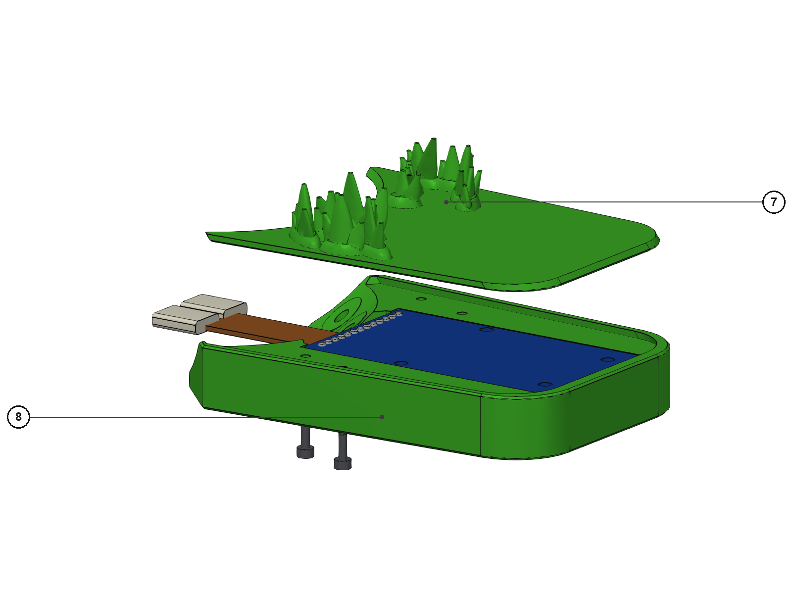

1. Wire the reader. Take the plug halves of the two 6-pin pairs with about 12 cm of wire. Solder ten wires to the reader's header row, coming from the component side: the first nine pads, +5V, +3.3V, RST, NSS, MOSI, MISO, SCK, BUSY, GND, and the pad IRQ. The pads GPIO, AUX and REQ stay empty. Cut flush whatever sticks out on the plain side. The header that comes with the board is not fitted: the plain side has to be flat.
2. Wire the hall switch. Its supply leg goes to the reader's +3.3V pad and its ground leg to GND, each with a short wire; its output leg takes the eleventh wire of the plugs. The twelfth wire stays free (table in `docs/electronics.md`). Insulate each joint with thin heat-shrink tube.
3. Glue the hall switch flat onto the floor of the pocket between the three small walls under the middle of the antenna, printed face up, legs pointing towards the ball. If the bench test of section 2 found the magnets of your figures elsewhere, glue it there instead; the floor is flat all over. Lay its wires along the floor.
4. Lay the reader into the pocket, components down, with the antenna at the tip of the tongue and the header end against the two stops at the rear. It rests on the ledge all round. Lead the wires side by side through the channel towards the ball and fix them there with a drop of hot glue. Two more drops at the corners keep the board from rattling.
5. Fit the grass top into its frame: hold it level, a little behind its place, and push it forwards and down, so that its bevelled front edge slips under the rim at the tip and the plate lies flush in the frame all round. Turn the tongue over and fasten the four M2 x 6 screws from below; their heads sit deep in the holes of the sole. The screws form their own thread in the roots of grass tufts in the two rear corners, so stop as soon as they are snug.

### Step 3: Screw the tongue under the bowl

Parts: **9** Screw M3 x 16 countersunk ISO 10642 (tongue to bowl)

1. Push the two plugs of the reader harness from outside through the window low on the front of the bowl, one after the other, and pull the wires in after them.
2. Set the bowl onto the hollow rear end of the tongue, with the U-shaped notch for the button above the tongue. The bowl rests on four small pads round the screw holes; everywhere else a gap of 0.25 mm remains. No part of the tongue reaches round the ball. With the bowl in place the grass top can no longer slide back out of its frame.
3. Hold both together, turn them over and fasten the four countersunk M3 x 16 screws into the lower inserts. Tighten gently and in turn.
4. Stand the device on a flat table. The underside of the tongue lies in the plane of the ball's flat foot, so both stand on the table together and the device must not rock. Printed parts differ by a tenth of a millimetre or two: if it rocks, a strip of adhesive tape on the four pads lowers the tongue and a few strokes of sandpaper on them raise it. Three thin felt dots, one under the flat of the ball and two under the tongue, hide whatever remains.
5. Look into the gap between grass and ball at the front: no wire may be pinched under the bowl.
6. The other order works as well: finish and test the whole ball first, then pull the two sockets of the core out through the window, plug them in, push the pairs back and screw the tongue on. The window lets a mated pair pass.

### Step 4: Fit the boards and the battery contacts

Parts: **10** Chassis, **11** 18650 contact plates (+ dimple, - spring), **12** Seeed XIAO ESP32-S3 Plus, **13** MAX98357A I2S amplifier, **14** TP4056 USB-C charger with protection, **15** 5 V boost converter (Adafruit MiniBoost TPS61023)

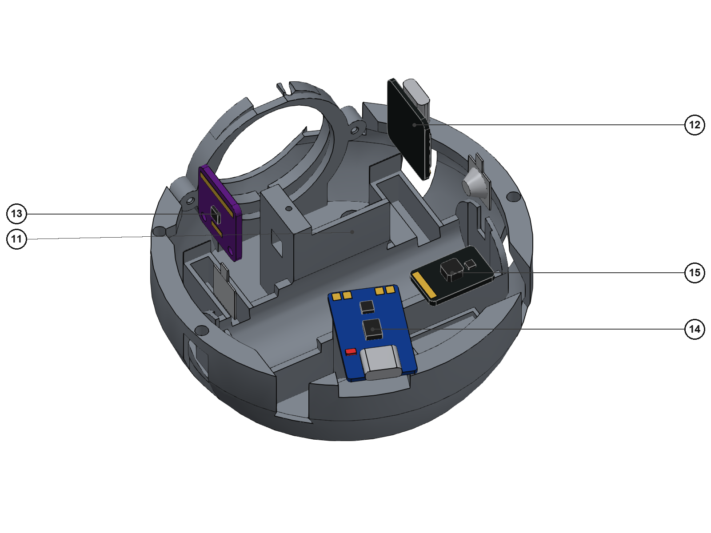

1. Wire the electronics on the bench first, following `docs/electronics.md`, and test them before anything goes into the chassis.
2. Slide the two contact plates into the slots at the ends of the battery cradle: the spring at the right-hand end (-Y, cell minus), the dimple at the left-hand end (+Y, cell plus). Their solder tabs point up.
3. Lay the charger on its shelf at the back left, between the two lips, with the USB-C socket pointing outwards and the inner end of the board against the stop block. The stop takes the push of the plug; a bed of epoxy or hot glue under the board holds it against the pull when unplugging. Check with the band held in place that the face of the socket ends just behind the band's surface; adjust `TP_L` in `params.py` if your module is longer or shorter than 28 mm.
4. Stand the XIAO upright in its pocket on the right (USB-C up) and the amplifier upright in the pocket on the left (pin row up). Lay the boost converter on its small shelf behind the battery. A drop of hot glue per board is enough.
5. Plug the XIAO's flexible antenna into its U.FL socket and stick it to the inside of the chassis wall on the right, as far from the cell as the lead allows.
6. Lead the two 6-pin sockets for the reader harness down through the rectangular window in the floor plate, with about 8 cm of wire below the plate.

### Step 5: Fit the servo

Parts: **16** 9 g micro servo (SG90 class), **17** Servo horn (stock single arm) + screw, **18** Servo mounting screw 2 x 8 (supplied with servo)

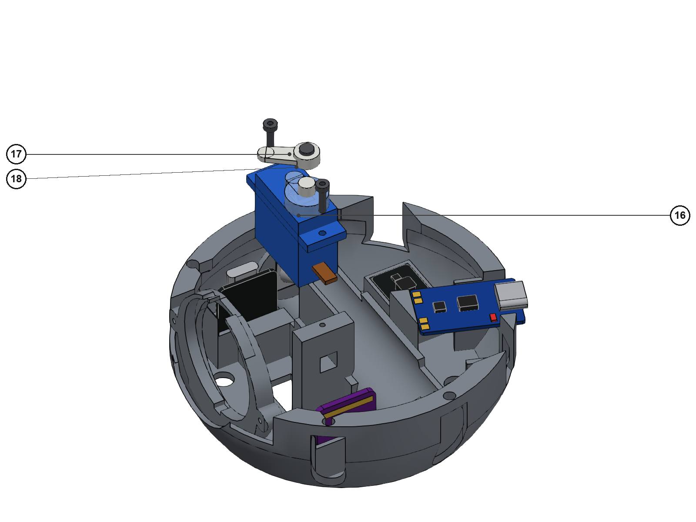

1. Shorten the single-arm servo horn to 13 mm from the centre of the shaft with side cutters. A longer arm would hit the latch pivot.
2. Lower the servo into its bay with the output shaft towards the left (+Y) and the cable in the slot. Fix it with the two screws that came with it.
3. Do not fit the horn yet: its angle is set during commissioning (section 6).

### Step 6: Build the front module: speaker, light and bezel

Parts: **19** Speaker Visaton K 40 (8 ohm), **20** Speaker clamp ring, **21** Screw M2 x 8 (speaker clamp), **22** RGB LED WS2812B on 10 mm PCB, **23** Light cone, **24** Button lens, **25** Button bezel (black ring with sound slits)

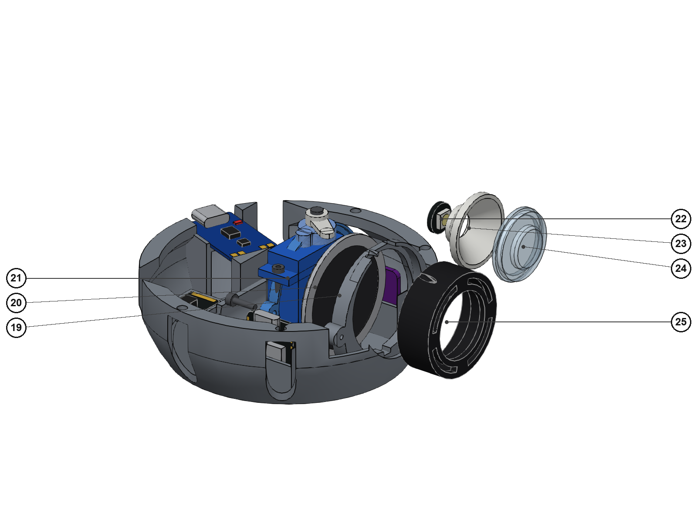

1. Solder two wires to the speaker. Seat the speaker against the back of the baffle (cone to the front) and clamp it with the clamp ring and two M2 x 8 screws, which form their own thread in the baffle. Reach them from behind with the long arm of the 1.5 mm hex key, past the servo, and turn the key by its short arm. The solder tags sit in the notch of the ring. A thin bead of glue around the rim makes the front chamber airtight.
2. Push the lens into the bezel from behind until its flange sits on the step. Push the white light cone in behind it; it holds the lens in place.
3. Solder three wires to the LED board, press it into the cup at the narrow end of the cone (LED facing the lens) and lead the wires out through the notch.
4. Glue the bezel into the socket of the baffle. The key under the tube fits only one way; the four slits then lie on the diagonals. Lead the LED wires out of the front chamber through the socket key notch and seal the notch with a drop of glue.

### Step 7: Lower the core into the bowl and insert the cell

Parts: **26** 18650 Li-ion cell (unprotected flat top)

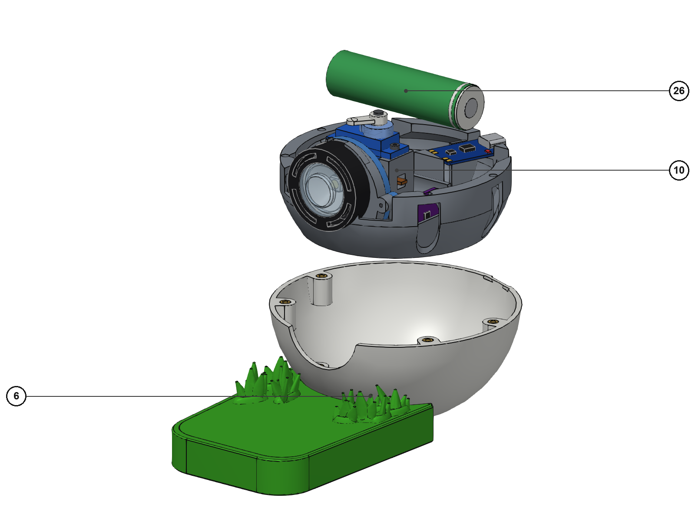

1. Hold the finished core over the bowl and join the two 6-pin plugs of the reader harness to the two sockets hanging under the chassis. Mark the pairs A and B so that they cannot be swapped.
2. Lower the core. The plugs and the spare wire fold into the space between the floor of the bowl and the chassis plate; the bezel slides into the U-shaped notch and the chassis flange comes to rest on the four bosses at the rim.
3. Snap the 18650 cell into the cradle, plus pole to the left (+Y), until the two side walls click over it.
4. If the charger's protection circuit stays off after a cell has been inserted, connect USB-C power once to wake it.

### Step 8: Fit the band

Parts: **27** Band (black equator ring)

1. Lower the black band over the core. Its notch slips over the USB-C socket, its gap over the bezel, and its skirt drops inside the rim of the bowl. The four lugs lie on the chassis flange, over the screw holes.
2. Optional: glue a 6 mm wide strip of black felt or fabric tape to the inside of the band below the shallow pocket at the back, standing 2 mm proud of the pocket. It closes the view into the hinge and bends away when the lid opens.

### Step 9: Assemble the stage: latch and ring lock

Parts: **28** Stage (inner dome with ring deck), **29** Latch pawl, **30** Pivot washer for the pawl, **31** Screw M2 x 6 (pawl pivot), **32** Compression spring 3.5 x 8 (pawl return), **33** Ring cradle, **34** Dowel pin 3 x 25 (ring lock), **35** Ring lock slider

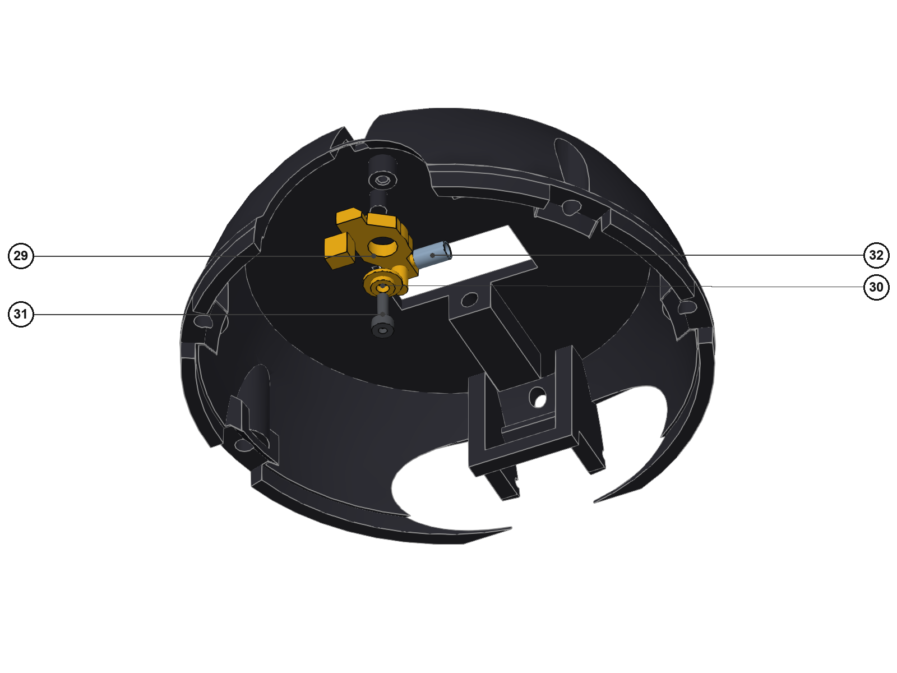

1. Turn the stage upside down. Put the pawl on the pivot boss (post pointing away from the deck) then the printed pivot washer, flange towards the pawl, and the M2 x 6 screw. The screw forms its own thread in the boss: turn it in until the washer sits on the end of the boss, and no further. The pawl must swing freely; the washer only keeps it from slipping off.
2. Put the short compression spring between the nub on the pawl's tail and the nub on the stage. It pushes the tail against the stop pin.
3. Turn the stage over. Line the ring slot of the cradle with self-adhesive felt on both sides until the ring slides in with light friction, then drop the cradle into its pocket in the deck.
4. Put the slider into its slot behind the cradle. Push the 3 x 25 mm dowel pin in from behind, through the hole in the rear wall of the stage and into the guide under the deck. It slides in the guide and in the cradle and is a press fit in the stem of the slider, which it takes along to the front end of the slot. Press it in against the edge of the table until it is flush with the rear wall, then push it on with the 2.5 mm hex key until its tip has crossed the ring slot and stops in the hole of the far wall. Do not force it further. Now move the slider: in the rear position the pin clears the ring slot and stands about 1 mm out of the back of its guide, in the front position it crosses the slot; in both positions it keeps the cradle captive.

### Step 10: Hinge the lid to the stage

Parts: **36** Lid (red upper half), **37** Dowel pin 2 x 8 (hinge), **38** Spring sleeve, **39** Torsion spring Gutekunst T-16324 (0.7 x 6.7, 7 coils)

1. Press one 2 x 8 mm pin into each hinge tower of the stage from outside, with flat pliers or against the table, until its tip is flush with the inner face of the tower. Both pins now stand 5 mm out of their towers and wait there. They must go in under firm pressure and then sit fast; if a pin does not go in, open the bore of the tower with a 2 mm drill.
2. Slip the printed sleeve into the torsion spring and check its winding direction now: hold the spring as it will sit, one leg pointing up and the other forwards, and push the upper leg down towards the front one, as the closing lid will do. The coil must wind tighter. If it opens instead, use the spring with the other winding direction (order both L and R). Once the pins are in, the spring can only be changed by cutting the sleeve.
3. Hold the spring between the two ribs of the lid so that one leg lies up along the inside of the lid's back wall and the other points forwards.
4. Hold the lid about 65° open behind the stage and slide it forwards until its two ribs lie between the hinge towers and their round ends line up with the round ends of the towers. The two waiting pins pass through the shallow channels inside the wall of the lid.
5. Squeeze the two pins towards each other with long-nose pliers, coming from above, one jaw on the end of each pin. The pins pass through the ribs and catch the sleeve at both ends. Stop when the jaws lie on the towers. The pins sit fast in the towers; lid and sleeve turn on them.
6. Lift the forward-pointing spring leg onto the yoke between the towers.
7. Close and open the lid by hand a few times. It must swing freely from closed to the end stop at about 95° and the spring must throw it open.
8. One long pin cannot be used in this hinge: the wall of the lid closes the hinge axis at both ends. To take the lid off again, cut the sleeve open with side cutters, take out sleeve and spring, and push each pin outwards with a small screwdriver until it has left the rib. Then print a new sleeve.

### Step 11: Screw the stage onto the core

Parts: **40** Screw M3 x 16 ISO 4762 (stack)

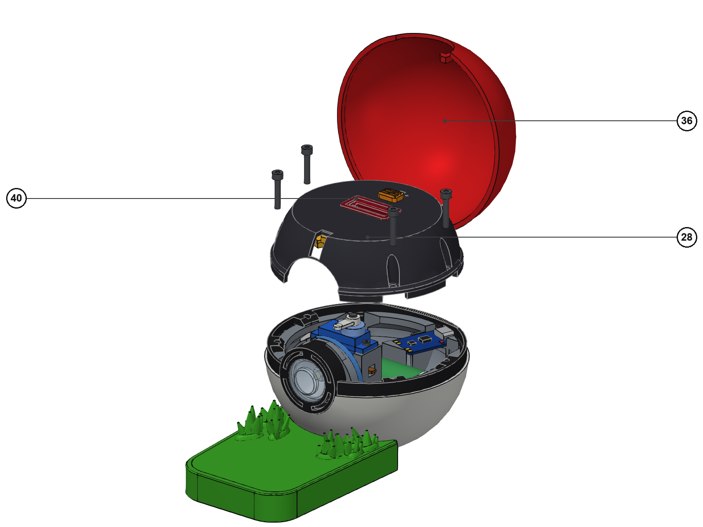

1. Open the lid. Lower the stage onto the core: its notch goes over the bezel, the pawl post drops in beside the servo, and the four screw wells line up with the band lugs.
2. Fasten the four M3 x 16 screws through the wells. They pass through stage, band lug and chassis flange into the inserts at the rim of the bowl and clamp the whole stack. Tighten gently.

### Step 12: Seat and lock the ring, close the lid

Parts: **41** Engagement ring (EU 49)

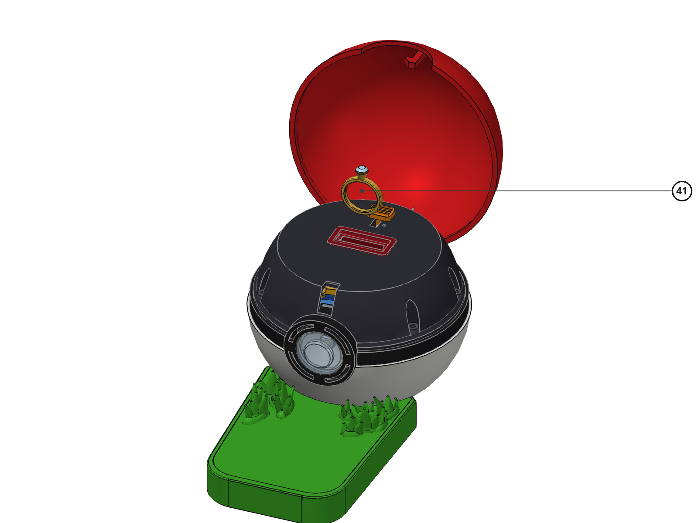

1. Pull the slider back, push the ring into the felt-lined slot until it sits on the bottom, and push the slider forwards until it clicks. The pin now passes through the ring below the deck: the ring cannot come out, however the ball is shaken or dropped.
2. Check that the servo is in its rest position, then press the lid down until the latch clicks.

## 6. Commissioning

*The latch seen from above with the deck removed, locked. The pawl (yellow) lies over the tooth of the lid hook (red). The servo arm rests clear of the pawl's post.*

*Released: the servo arm has pushed the post, the pawl has turned and its nose has left the tooth.*

1. **Set the horn.** With the stage off and the servo commanded to its rest pulse, push the trimmed horn onto the shaft pointing about 35° to the right of straight ahead (towards -Y), and fit its screw. At the release pulse it should point about 5° to the right of straight ahead. Store both pulse widths in the firmware; never command a position beyond them.
2. **Test the latch with the stage on and the lid open.** Command release: the pawl nose must swing clear of the hook slot. Command rest: the pawl must return against its stop pin by its own spring.
3. **Test the opening.** Close the lid (press until it clicks) and command release. The lid must open fully. Repeat twenty times.
4. **Test the emergency opening** described below, so that you know the feel of it.
5. **Test the tongue.** Stand each figure at the front end, its foot about 2 mm short of the front edge: the ball must wake and read it, also when the figure stands 8 mm further back or to one side. Leave a figure standing: the ball must go back to sleep and stay asleep.
6. **Register the four Tonies and upload the messages** once the firmware exists.

## 7. Using the ball

### Presenting a Tonie

| | |
| --- | --- |
|  | 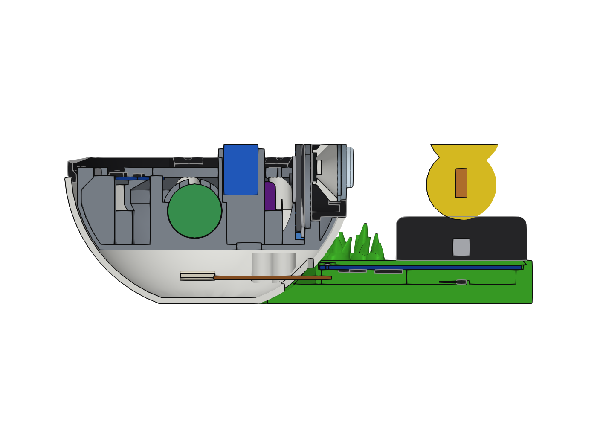 |

Stand the device on a table or on the ground and stand the Tonie at the front end of the tongue, in the middle between its two sides: its foot then ends about 2 mm short of the front edge and leaves about 10 mm on each side. That wakes the ball. No mark shows the place; the front end is the cue. The reader's antenna lies 1.7 to 3.3 mm below the surface, centred under that place; the tag itself is a small rod further up inside the figure.

Nothing holds the figure. It stands on a plain, level surface without recess or catch. The thin line that runs round the front end is the joint between the grass top and the rim of the tray; both are level, and the front edge of the foot stands on the rim. The grass stands only in the two corners beside the ball, in tufts of different sizes thrown at random; the sides and the front of the figure are open. Whoever carries the device has to hold the figure separately, as on any tray. On a shelf the figure simply stands on the tongue; the firmware lets the ball sleep while a figure stays there.

### Charging

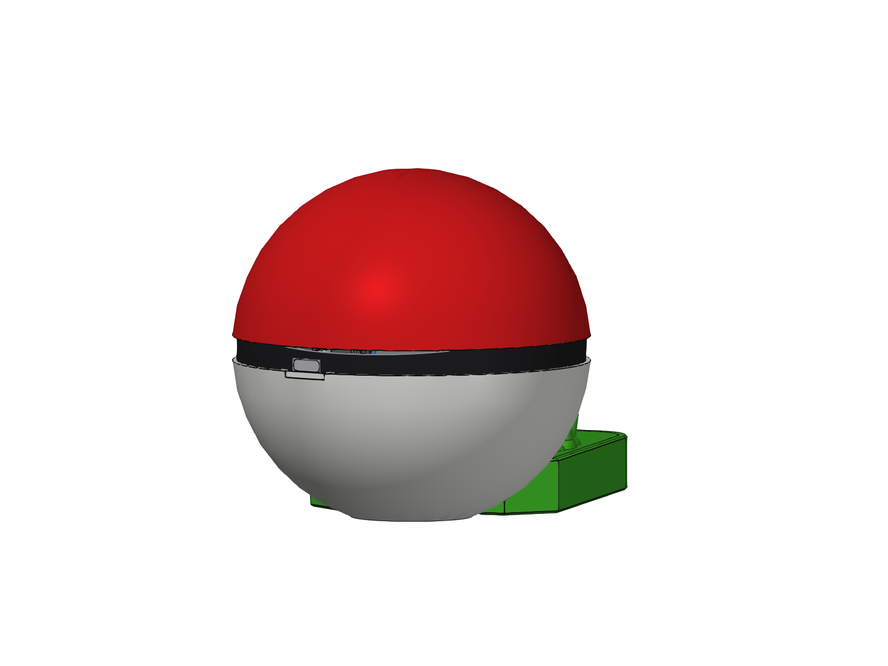

The USB-C socket sits in the black band at the back, 20° to the left of the hinge. The shallow scoop in the white rim below it makes room for the body of the plug. A charge at 0.5 A takes about 7 hours. Do not run the hunt from the charger: the charger has no power path and will not terminate while the ball is active.

### Emergency opening

*Section along the path of the paper clip (orange).*

If the electronics fail, the lid can still be opened without leaving a mark. Straighten a paper clip (wire up to 1.2 mm). Looking at the button, insert it into the **upper left slit**, near the upper end of that slit, about 6 mm left of the vertical centre line. Aim 22° upwards. After about 17 mm the clip meets resistance; push 3 mm further. The clip leaves the bezel through a slot in its wall and pushes the pawl aside; the lid springs open. Nothing on the outside shows that this is possible.

### Closing the lid

Press the lid down until the latch clicks. The tooth of the hook pushes the pawl aside by itself; the servo is not needed.

### Releasing the ring

| Locked | Released |
| --- | --- |
|  | 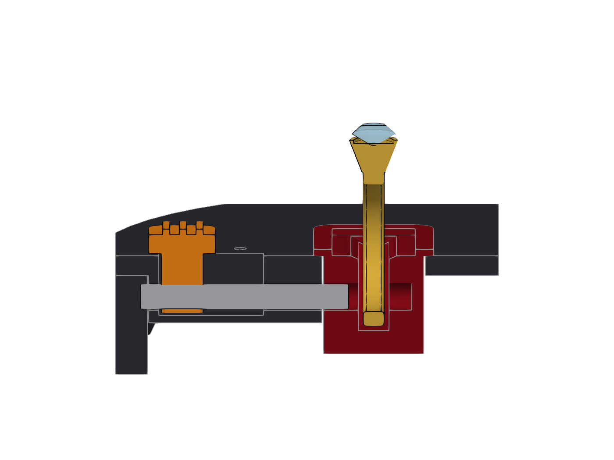 |

Pull the slider behind the ring back by 7 mm. The pin leaves the ring and the ring lifts out.

### The hinge

| Closed | Open |
| --- | --- |
| 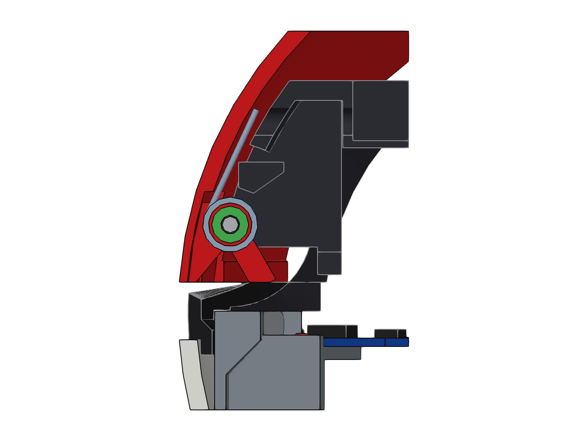 |  |

The hinge lies inside the lid, on two short pins in the towers of the stage. While the lid opens, its rear rim dips into a shallow pocket in the top edge of the black band. That pocket is the only trace of the hinge on the outside; it is black, lies under the overhanging lid and can be closed with the felt strip from step 8.

## 8. Service

**Swapping the cell**

1. Open the lid (by command or with the paper clip) and unlock and remove the ring.
2. Undo the four M3 screws in the wells of the stage and lift the stage with the lid straight up.
3. Lever the cell out of its cradle and snap in a charged one, plus pole to the left.
4. Put the stage back and fasten the four screws.

To take out the whole core, also lift off the band and separate the two 6-pin plugs under the chassis.

**Opening the grass tongue**

1. Undo the four countersunk screws under the rear end of the tongue and lift the ball a few centimetres off it.
2. Pull the two plug pairs out through the window in the bowl and separate them. The ball is now free.
3. Undo the four small screws, lift the rear of the grass top a little and draw it backwards out from under the rim at the tip; the reader lies open.

## 9. Exploded view

| Pos. | Part | Qty | Kind |
| --- | --- | --- | --- |
| 1 | Bowl (white lower half) | 1 | printed |
| 2 | Heat-set insert M3 x 5.7 | 8 | hardware |
| 3 | Grass tongue (tray) | 1 | printed |
| 4 | PN5180 NFC reader (blue board, 70 x 39 mm) | 1 | purchased |
| 5 | Hall switch, TO-92 (DRV5032FB or AH3661UA) | 1 | purchased |
| 6 | Reader harness: 6-pin plug-and-socket pair with wires | 2 | purchased |
| 7 | Grass top (turf plate with its tufts) | 1 | printed |
| 8 | Screw M2 x 6 (grass top to tray) | 4 | hardware |
| 9 | Screw M3 x 16 countersunk ISO 10642 (tongue to bowl) | 4 | hardware |
| 10 | Chassis | 1 | printed |
| 11 | 18650 contact plates (+ dimple, - spring) | 2 | purchased |
| 12 | Seeed XIAO ESP32-S3 Plus | 1 | purchased |
| 13 | MAX98357A I2S amplifier | 1 | purchased |
| 14 | TP4056 USB-C charger with protection | 1 | purchased |
| 15 | 5 V boost converter (Adafruit MiniBoost TPS61023) | 1 | purchased |
| 16 | 9 g micro servo (SG90 class) | 1 | purchased |
| 17 | Servo horn (stock single arm) + screw | 1 | purchased |
| 18 | Servo mounting screw 2 x 8 (supplied with servo) | 2 | hardware |
| 19 | Speaker Visaton K 40 (8 ohm) | 1 | purchased |
| 20 | Speaker clamp ring | 1 | printed |
| 21 | Screw M2 x 8 (speaker clamp) | 2 | hardware |
| 22 | RGB LED WS2812B on 10 mm PCB | 1 | purchased |
| 23 | Light cone | 1 | printed |
| 24 | Button lens | 1 | printed |
| 25 | Button bezel (black ring with sound slits) | 1 | printed |
| 26 | 18650 Li-ion cell (unprotected flat top) | 1 | purchased |
| 27 | Band (black equator ring) | 1 | printed |
| 28 | Stage (inner dome with ring deck) | 1 | printed |
| 29 | Latch pawl | 1 | printed |
| 30 | Pivot washer for the pawl | 1 | printed |
| 31 | Screw M2 x 6 (pawl pivot) | 1 | hardware |
| 32 | Compression spring 3.5 x 8 (pawl return) | 1 | hardware |
| 33 | Ring cradle | 1 | printed |
| 34 | Dowel pin 3 x 25 (ring lock) | 1 | hardware |
| 35 | Ring lock slider | 1 | printed |
| 36 | Lid (red upper half) | 1 | printed |
| 37 | Dowel pin 2 x 8 (hinge) | 2 | hardware |
| 38 | Spring sleeve | 1 | printed |
| 39 | Torsion spring Gutekunst T-16324 (0.7 x 6.7, 7 coils) | 1 | purchased |
| 40 | Screw M3 x 16 ISO 4762 (stack) | 4 | hardware |
| 41 | Engagement ring (EU 49) | 1 | purchased |

