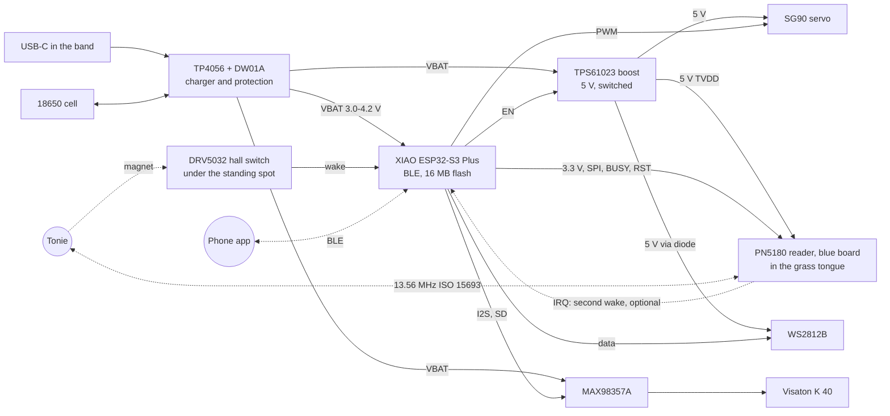
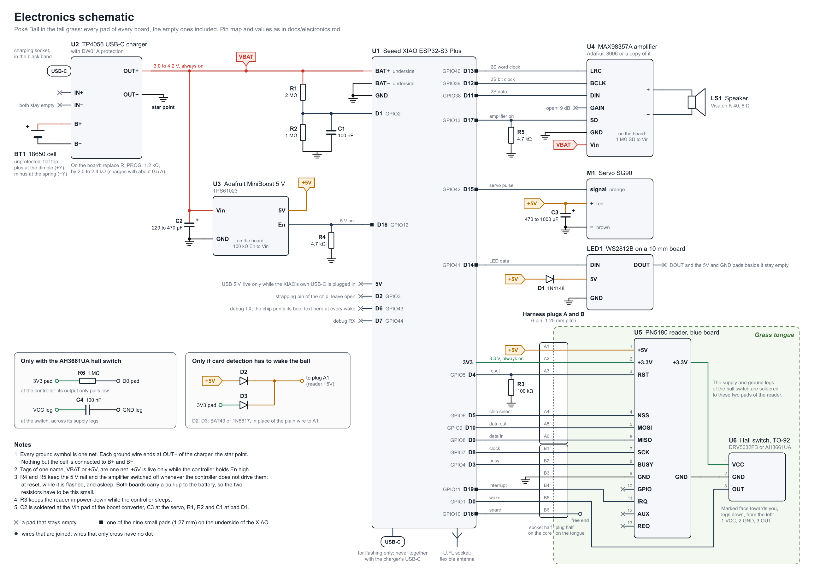

# Electronics: wiring, power and what the firmware has to respect

No firmware or app exists yet. This document fixes the hardware side so that both can be written later, and it summarises why the chosen parts can do the job. Every statement is backed by the research notes in `research/`; the note and section are given in brackets.

## Block diagram

## Schematic

The schematic shows every pad of every board, the ones that stay empty included. Click it for the drawing itself, `img/schematic.svg`, which can be enlarged without losing sharpness. It is drawn by `uv run poketonieengagementhunt schematic`; pads, pins and values are those of the tables in this document.

Parts that are not on one of the boards:

| Part | Value | Where | What for |
| --- | --- | --- | --- |
| R1, R2 | 2 MOhm, 1 MOhm | from VBAT to pad `D1`, from `D1` to ground | battery voltage divider |
| C1 | 100 nF | from pad `D1` to ground | quiet reading at the ADC pin |
| R3 | 100 kOhm | from pad `D4` to ground | reader in hard power-down while the controller sleeps |
| R4 | 4.7 kOhm | from pad `D18` (boost `En`) to ground | 5 V rail off while the controller does not drive the pin |
| R5 | 4.7 kOhm | from pad `D17` (amplifier `SD`) to ground | amplifier shut down while the controller does not drive the pin |
| C2 | 220-470 µF, 10 V | across `Vin` and `GND` of the boost converter | bulk capacitor on the battery rail |
| C3 | 470-1000 µF, 10 V | across the red and the brown wire of the servo | start-up current of the servo |
| D1 | 1N4148 | in the LED's `5V` wire | lowers the LED supply so that 3.3 V data is in spec |
| R6, C4 | 1 MOhm, 100 nF | from `D0` to `3V3`; across the supply legs of the hall switch | only with the AH3661UA hall switch |
| D2, D3 | BAT43 or 1N5817 | from the 5 V rail and from `3V3` to wire A1 | only if card detection has to wake the ball |

Pads that stay empty, and why:

| Board | Pad | Why it is not used |
| --- | --- | --- |
| XIAO | `5V` | carries USB voltage, and only while the XIAO's own USB-C is plugged in; the ball is fed through `BAT+ / BAT-` |
| XIAO | `D2` (GPIO3) | strapping pin of the chip |
| XIAO | `D6`, `D7` (GPIO43, 44) | debug port; the chip prints its boot text on `D6` at every wake |
| Charger | `IN+`, `IN-` | parallel to the USB-C socket, which feeds the charger |
| Amplifier | `GAIN` | open means 9 dB |
| LED | `DOUT` and the `5V` and `GND` pads beside it | output for a further LED |
| Reader | `GPIO` | an output of the chip for switching an external transmitter supply; the controller switches the boost converter itself |
| Reader | `AUX` | test signal of the chip |
| Reader | `REQ` | asks the chip for a download of its own firmware; the chip pulls the pin low by itself during reset [PN5180 data sheet, §11.2.1.2] |

Legs of the hall switch, both types: marked face towards you, legs down, from the left supply, ground, output.

## Power

| Rail | Source | Loads | Notes |
| --- | --- | --- | --- |
| Cell | one unprotected flat-top 18650 | TP4056 module `B+ / B-` | Never connect loads to `B+`; use `OUT+ / OUT-`, which sit behind the protection [05 §4.1] |
| VBAT, 3.0-4.2 V | TP4056 `OUT+ / OUT-` | XIAO `BAT+ / BAT-` pads, amplifier `Vin`, boost `Vin`, battery divider | 220-470 µF bulk capacitor (C2) close to the boost input [05 §5] |
| 3.3 V | regulator on the XIAO | PN5180 logic supply (`+3.3V` pad), hall switch, pull-ups | reader and hall switch are fed through the harness |
| 5 V switched | Adafruit MiniBoost (TPS61023), enable from GPIO12 with a 4.7 kOhm pull-down (R4) | servo, PN5180 `+5V` pad (transmitter), LED | 470-1000 µF (C3) at the servo. Off in deep sleep, which removes servo, LED and transmitter idle current [05 §5] |

- **Charging.** USB-C into the TP4056 module. Replace its 1.2 kOhm programming resistor by 2.0-2.4 kOhm: about 0.5 A, 0.7 W of heat instead of 1.4 W inside a closed plastic ball, roughly 7 hours for a full charge [05 §4.1].
- **No power path.** The TP4056 cannot tell load current from charge current. Charge with the ball asleep [05 §4.1].
- **Two chargers.** The XIAO has its own 100 mA charger on the `BAT` pads. It only becomes active when the XIAO's own USB-C port is plugged in for flashing. Do not power both USB-C ports at the same time [07 §16 C].
- **Cut-off.** The DW01A protection trips at 2.4 V, which is too deep for regular use. The firmware has to stop at about 3.3 V resting voltage and go to sleep [05 §4.1].
- **Protection trip.** The worst-case over-current trip is about 1.7 A; a stalled servo draws 1.3-1.5 A from the cell. The firmware must never drive the servo into a hard stop and must not run servo, reader field and audio together [05 §4.1, §5].

### What keeps the 5 V rail and the amplifier off

The pins of the controller drive nothing while it is in reset, while it is being flashed, and in deep sleep unless the firmware holds them. In those states resistors alone decide whether the boost converter and the amplifier are on. Both boards carry a pull-up to the battery, so a pull-down forms a divider with it and has to be much smaller than the pull-up [05 §4.3, 04 §2.2]:

| Input | On the board | Off below | 100 kOhm to ground gives | 4.7 kOhm to ground gives |
| --- | --- | --- | --- | --- |
| Boost `En` | 100 kOhm to `Vin` | 0.35 V; on above 1.2 V | 1.5-2.1 V: on | 0.13-0.19 V: off |
| Amplifier `SD` | 1 MOhm to `Vin`, and 100 kOhm to ground inside the chip | 0.16 V typically | 0.14-0.20 V: on or off, by chance | 13-19 mV: off |

- Hence R4 and R5 are 4.7 kOhm. A pin that is high feeds 0.7 mA into its resistor, which does not matter while the rail or the amplifier is in use.
- A board from another maker can carry another pull-up. Measure it, unpowered, between `En` and `Vin` and between `SD` and `Vin`: the pull-down must be at most a twentieth of the pull-up on the boost board and at most a hundredth of the one on the amplifier board.
- While the rail is off, 29-40 µA flow from the cell through the pull-up of the boost board and 3-4 µA through that of the amplifier. Removing the pull-up from the boost board saves the larger part: it is the one of its two 100 kOhm resistors that connects the pads `En` and `Vin`. R4 then holds the pin alone.
- An amplifier that is not shut down draws 340 µA without clocks; a boost converter that is not switched off keeps servo, LED and the reader's transmitter supplied.

### Budget on a 3350 mAh cell [05 §5.1, §5.2]

| State | Current from the cell | Runtime |
| --- | --- | --- |
| Deep sleep, 5 V rail off | 70-130 µA (estimate from datasheets); 30-90 µA without the pull-up on the boost board | more than a year; self-discharge dominates |
| Awake, BLE connected | 35-60 mA | about 63 h |
| Reader field on continuously | about 0.35 A | about 8 h |
| Speech at moderate volume | 130-180 mA | 16-22 h |
| Servo stall | 1.3-1.5 A | must not last |

## Net list

Pad names of the XIAO ESP32-S3 Plus: D0-D10 are the large pads on the two long edges, D11-D19 are the 1.27 mm half-holes on the underside. Seven of the mandatory signals need the small pads [07 §11.3]. The fallback board (Unexpected Maker TinyS3) has every pin on 2.54 mm headers but needs a longer pocket.

| Signal | GPIO | XIAO pad | To | Remarks |
| --- | --- | --- | --- | --- |
| Wake | 1 | D0 | hall switch `OUT` (in the grass tongue) | low while a magnet is over it. DRV5032FB: push-pull output, no pull-up. AH3661UA: open-drain output, 1 MOhm from this pad to `3V3` |
| Second wake (optional) | 11 | D19 | PN5180 `IRQ` | only for low-power card detection, see "Wake" below [07 §11.3] |
| Spare | 10 | D16 | sixth wire of plug B | free for a second hall switch; Seeed labels the pad `ADC_BAT`, check that it is not tied to the battery [07 §11.3] |
| Battery sense | 2 | D1 | divider R1 2 MOhm (to VBAT) / R2 1 MOhm (to GND), C1 100 nF to GND | ADC1, 6 dB attenuation, about 1.4 µA drain [07 §10] |
| (unused) | 3 | D2 | | strapping pin, leave open |
| Reader BUSY | 4 | D3 | PN5180 `BUSY` | mandatory flow control line |
| Reader RST | 5 | D4 | PN5180 `RST` | R3, 100 kOhm pull-down: hard power-down in sleep. The reader board has no pull-up on this line |
| Reader NSS | 6 | D5 | PN5180 `NSS` | |
| Reader SCK | 7 | D8 | PN5180 `SCK` | |
| Reader MISO | 8 | D9 | PN5180 `MISO` | |
| Reader MOSI | 9 | D10 | PN5180 `MOSI` | |
| Debug TX / RX | 43 / 44 | D6 / D7 | | ROM boot text appears on TX at every wake |
| 5 V enable | 12 | D18 | boost `En` | R4, 4.7 kOhm pull-down, see "What keeps the 5 V rail and the amplifier off" |
| Amplifier shutdown | 13 | D17 | MAX98357A `SD` | R5, 4.7 kOhm pull-down; an amplifier left enabled without clocks draws 340 µA |
| I2S data | 38 | D11 | MAX98357A `DIN` | |
| I2S bit clock | 39 | D12 | MAX98357A `BCLK` | |
| I2S word clock | 40 | D13 | MAX98357A `LRC` | |
| LED data | 41 | D14 | WS2812B `DIN` | |
| Servo PWM | 42 | D15 | servo signal (orange) | LEDC, 50 Hz, 14 bit |

Remaining connections:

| From | To |
| --- | --- |
| TP4056 `B+` / `B-` | cell contact plates (plus at +Y, minus at -Y) |
| TP4056 `OUT+` / `OUT-` | XIAO `BAT+` / `BAT-`, amplifier `Vin` / `GND`, boost `Vin` / `GND`, divider top |
| XIAO `3V3` | PN5180 `+3.3V`, hall switch `VCC` |
| Boost `5V` | servo red, PN5180 `+5V`, anode of a 1N4148 (D1) whose cathode feeds the LED `5V` |
| Amplifier `+` / `-` | speaker |
| Amplifier `GAIN` | leave open (9 dB) or tie as needed |
| All grounds | common, star point at the TP4056 `OUT-` |

Why the diode in the LED supply: a WS2812B on 5 V wants 3.5 V for a logic high, more than a 3.3 V GPIO delivers. One diode drop brings the LED supply to about 4.3 V and the threshold to about 3.0 V [07 §9].

The reader's `GPIO`, `AUX` and `REQ` pads stay unconnected.

## Harness between the grass tongue and the core

Reader and hall switch sit in the grass tongue; the controller sits in the ball. Twelve wires join them. They leave the tongue through a channel at its rear end, enter the bowl through a window low on its front that the tongue hides, and end in two 6-pin plug-and-socket pairs that lie under the chassis plate. Solder the wires to the reader's pads directly; a pin header does not fit under the turf. The hall switch takes its supply and its ground from the reader's `+3.3V` and `GND` pads, so only its output needs a wire of its own.

| Plug | Pin | Signal | Soldered to | Goes to |
| --- | --- | --- | --- | --- |
| A | 1 | 5 V switched | reader `+5V` | boost `5V` |
| A | 2 | 3.3 V | reader `+3.3V`, hall `VCC` | XIAO `3V3` |
| A | 3 | reset | reader `RST` | GPIO5 |
| A | 4 | chip select | reader `NSS` | GPIO6 |
| A | 5 | data to the reader | reader `MOSI` | GPIO9 |
| A | 6 | data from the reader | reader `MISO` | GPIO8 |
| B | 1 | clock | reader `SCK` | GPIO7 |
| B | 2 | busy | reader `BUSY` | GPIO4 |
| B | 3 | ground | reader `GND`, hall `GND` | ground star point |
| B | 4 | interrupt | reader `IRQ` | GPIO11 |
| B | 5 | hall output | hall `OUT` | GPIO1 |
| B | 6 | spare | a second hall switch, if one is fitted | GPIO10 |

- Plugs: 6-pin wire-to-wire pairs with 1.25 mm pitch (Molex PicoBlade 51021 / 51047 or the clones sold as "Micro JST 1.25"), pre-wired with 28 AWG. A mated pair is 9.25 x 3.2 mm across; the window lets 15.5 x 6.5 mm pass. JST PH has no wire-to-wire part, and its in-line clones are too thick to pass the window mated [10 C1].
- Keep the harness to about 12 cm on the tongue side and 8 cm on the core side.
- Both supplies run through plug A and the only ground through plug B. Join and part the plugs with the cell taken out. Where that is not possible, join B first and part it last, so that the reader never has a supply without its ground.
- The wire colours of the two halves of a bought pair need not agree. Mate each pair and follow every wire across it before soldering.
- The reader library runs the SPI bus at 7 MHz by default (`PN5180.cpp` of `tueddy/PN5180-Library`). Over 20 cm of loose wire and a connector, set it to 1-2 MHz with `setSPISettingsFrecuency()`; a tag read does not get noticeably slower [02 §2.1].
- The 5 V wire carries the transmitter current, typically 180 mA and at most 250 mA while the field is on [02 §1C]. Each PicoBlade contact is rated 1 A, and 40 cm of 28 AWG there and back drops about 20 mV.

## Reader and Tonies

- Tonies carry an NXP ICODE SLIX-L tag (ISO 15693, 13.56 MHz) that is kept in privacy mode: it stays silent until it receives GET RANDOM NUMBER (`02 B2 04`) followed by SET PASSWORD (`02 B3 04 04` + four password bytes, each XORed with the random number). After that a normal INVENTORY returns the 8-byte UID, which begins with `E0 04 03` and is unique per figure [01 §2, §4].
- The password bytes on air are `5B 6E FD 7F`. The Flipper Zero firmware writes this as `0x5B6EFD7F`, the Toniebox community firmware as `0x7FFD6E5B`; both are the same four bytes. If a figure does not answer, try the NXP default `0F 0F 0F 0F` [01 §2, 02 §2.4].
- The unlock writes nothing and cannot damage a figure. A wrong password only makes the tag ignore commands until the field is switched off and on again. Never send WRITE PASSWORD, LOCK PASSWORD or DESTROY [01 §3].
- The unlock is persistent: a figure stays readable by any ISO 15693 reader until a Toniebox locks it again, which according to the community wiki the box does after every read. The firmware can also re-lock a figure itself with ENABLE PRIVACY (`0xBA`) and the same password. Confidence medium-high; verify on the bench [01 §3].
- The reader is the common blue PN5180 board (69.6 x 38.6 mm). It lies in the grass tongue with its components down and its plain side against the turf, so that the centre of its antenna is exactly under the standing spot. The antenna copper is 1.7 to 3.3 mm below the surface a figure stands on; revision 1, with the Elechouse board inside the ball, had 10.6 mm [08 §0, `docs/verification.md`].
- The tag is not in the sole of the figure. In the classic Tonies it is an upright ferrite rod of about 10 x 4 mm that sits 20 to 50 mm above the underside; where it sits in the Pokémon figures is not known. A Toniebox reads such a rod from 2 to 75 mm above its top. The rod couples to the vertical field on the axis of the antenna, which is why the standing spot is centred on the antenna [09 §8].
- This is the board, and nearly the arrangement, of the published field reports: ESPuino users read original Tonies standing on 6 mm of plastic and 2 mm of air above this antenna, with the tag as high in the figure as it happens to be [02 §2.4, §3.1].
- A forum screenshot of November 2026 shows UIDs beginning `E0 04 03 50` for Bisasam, Glumanda and Schiggy: the first direct evidence, from a single source, that the Pokémon Tonies carry the same SLIX-L tag [09 §8].
- Nearest metal: the four small screws of the grass top, 13 mm from the antenna loop at the nearest, and whatever the tongue stands on. Since revision 3 the tongue is 15 mm high, which puts the antenna copper 11.7 mm above the table instead of 3.2 mm. That is a little more than the 10 mm that TI's antenna guide asks for between an antenna and a metal surface, and the coupling estimate of note 08 falls from about 0.35 to about 0.08 over that distance [08 §8]. If a metal table still disturbs reading, a ferrite sheet of 0.1-0.2 mm on the floor of the pocket, 5 mm under the board, is the remedy to try [08 §8].
- Library: `tueddy/PN5180-Library` with `disablePrivacyMode()`, as used by ESPuino, where users report reading original Tonies with a PN5180 and an ESP32 [02 §2].
- Not verified: how high the tag sits in the Pokémon figures and whether this antenna reaches it with margin; how the board behaves with metal under the tongue; where the magnets sit in the black foot. All are the first thing to test (building manual, section 2).

## Behaviour the hardware is built for

- **Sleep.** Deep sleep is the resting state: 5 V off, amplifier shut down, reader in hard power-down, radio off [07 §12.2].
- **Wake.** A magnet in the foot of a Tonie that is stood on the spot pulls the hall switch low and wakes the chip. No button is needed. The same wake starts BLE advertising for a couple of minutes, which is how the owner connects the app at the start of the hunt.
- **The magnets the switch is laid out for.** Nobody has published where the magnets sit in the black foot of the Pokémon figures. They are sold for the first Toniebox as well, so by the owner's decision the tongue assumes the magnets of the classic Tonies: cylinders of 6 x 6 mm whose pole face lies 1 to 2 mm above the underside, one in the middle of the foot or one in each of two feet about 20 mm apart [09 §7]. The hall switch lies on the floor of the pocket on the axis of the spot, 6.8 mm below the standing surface, so that its element is 8.3 to 9.3 mm below such a pole face. That depth is chosen for magnets that are not on the axis: closer to the foot the field of a magnet 10 mm to the side passes through zero, further away everything gets weak [09 §7]. At this depth an ideal magnet on the axis gives 19 to 24 mT, one that is 8 mm off the axis about 6 mT, and two magnets 20 mm apart with like poles down about 6.5 mT between them (`docs/verification.md`). The switch needs 3 mT typically and 4.8 mT at the latest [04 §5]. Since revision 4 nothing marks the spot; the owner decided so and accepted the risk. The front end of the tongue is the only cue: the foot of a centred figure ends 2 mm short of the front edge and leaves 10.5 mm of ground on each side. Reader and switch are expected to tolerate about 8 mm; a figure put down by eye can stand further off than that. If reading or waking then fails in use, this is the part to redesign: the spot gets a mark again.
- **Wake, if the magnet is not where the switch is.** One switch on the axis does not cover two magnets with unlike poles down, whose fields cancel between them, or magnets much weaker than assumed. Two answers are prepared. Glue the switch, or a second one on the spare wire, where the bench test finds the field; the floor of the pocket is flat all over. Otherwise use the reader's own low-power card detection: the reader wakes by itself about once a second, notices the metal of the magnets and the tag over its antenna, and raises `IRQ`, which is wired to GPIO11. That costs 35-220 µA in sleep instead of 1 µA, needs reader firmware 4.0 or later, and needs the reader's `+5V` pad supplied in sleep: feed that one wire through two Schottky diodes, one from the 5 V rail and one from 3.3 V [07 §6.5, 02 §6].
- **If the DRV5032FB cannot be had: AH3661UA.** The AH3661UA of Nanjing AH Electronic, which Conrad sells as TRU COMPONENTS under order number 1569221, has the same TO-92 body and the same order of legs (supply, ground, output, seen on the printed face), answers to either pole and pulls its output low for a magnet, like the TI part [04 §5]. Seat, wires and firmware stay as they are. Three things differ. Its output is open-drain: solder 1 MOhm between pad D0 and `3V3` at the controller. Without the resistor the controller's internal pull-up works as well, but then about 70 µA flow for as long as a figure stands on the spot. It switches at 3.5 mT typically and at 7 mT at the latest, where the TI part needs 3 and 4.8 mT. On the axis that changes nothing (19 to 24 mT), but a part at the upper limit catches a magnet only up to about 7 mm off the axis instead of about 9 mm, and not two like magnets 20 mm apart. So buy three or four, try on the bench from what distance each answers to the same magnet, and fit the one that answers from furthest away. It draws 2.75 µA on average (5.25 µA at most) instead of 0.7 µA, which does not matter beside the controller's own sleep current. Its data sheet asks for 10 to 100 nF across the supply legs.
- **Stand-alone message.** Wake, switch on 5 V, unlock and read the tag, switch the field off, play that figure's file from flash once, sleep. BLE is not involved [07 §12.2].
- **A figure that stays.** On a shelf a figure may stand on the spot for months, and the hall output then stays low. The firmware therefore arms the wake-up for the opposite level every time it goes to sleep: with a figure present it wakes when the pin goes high (figure lifted), with the spot empty when it goes low (figure placed). The ESP32-S3 offers both levels for this wake source [07 §7.1]. The hall switch draws the same 0.7 µA in either state [04 §5]. Card detection needs no such rule: it compares with the state in which it was started.
- **Starting the hunt.** The ball has no button. To start, wake it with a magnet held at the front end of the tongue, where a figure would stand: the figures are hidden by then, and the hall switch answers to either pole of any small magnet. Connect the app during the two minutes of advertising and send the start command. The phone has to be bonded once beforehand, on the bench; the ball accepts a new bond only in the first two minutes after the cell has been inserted.
- **Hunt mode.** From the start command until the app ends the hunt or opens the lid, the ball does not go to sleep. It keeps the link, advertises again whenever the link drops, and stores in non-volatile memory that a hunt is running, so that a reset brings it back into the hunt and not into sleep. A figure on the spot is then reported to the app as well as played. Awake, the ball draws 35-60 mA, which one cell supplies for more than two days [05 §5.2, 07 §12.2]. Without a running hunt, a figure on the spot only plays its message and the ball goes back to sleep.
- **Hunt.** The phone computes its distance to the next hiding place and sends only a blink pattern; expect to resolve distance bands of 10-20 m, not metres [07 §5.3]. Hints are clips stored on the ball and started by the app. Live audio from the phone is not possible: the ESP32-S3 has no Bluetooth Classic [07 §4.3].
- **Messages.** MP3, mono, 44.1 kHz, 48-64 kbit/s, in a LittleFS partition; 16 MB flash holds about 19 minutes. Upload over BLE in acknowledged chunks; a 500 kB clip takes 6-60 s depending on the phone [07 §3, §4.1].
- **Opening.** Stop audio and reader, enable 5 V, wait 10-20 ms, start PWM at the rest position, move to the release position, wait, stop PWM, disable 5 V. Refuse below about 3.4 V under load. The latch holds and releases without servo torque, so the servo is unpowered at all other times [07 §8].

## Checks before closing the ball

1. Charger: with a cell in, `OUT+` shows the cell voltage. If not, plug in USB-C once to release the protection.
2. Off states, measured while the reset button of the XIAO is held down: boost `En` below 0.3 V and its `5V` pad at 0 V, amplifier `SD` below 0.05 V. If one of them is higher, the board carries a stronger pull-up than assumed: see "What keeps the 5 V rail and the amplifier off".
3. Sleep current at the cell: below 0.15 mA, and below 0.1 mA if the pull-up has been taken off the boost board. If it is higher, look for an enable pin that the firmware does not hold.
4. 5 V rail: 5.0 V when enabled, 0 V when disabled.
5. Servo sweep between the two stored positions while a clip plays: no reset.
6. All four figures read on the spot, with the core in the bowl and the cell fitted, once with the device standing on wood and once on metal.
7. With a figure left on the spot the ball goes to sleep and stays asleep; lifting the figure and putting it back plays the message again.
